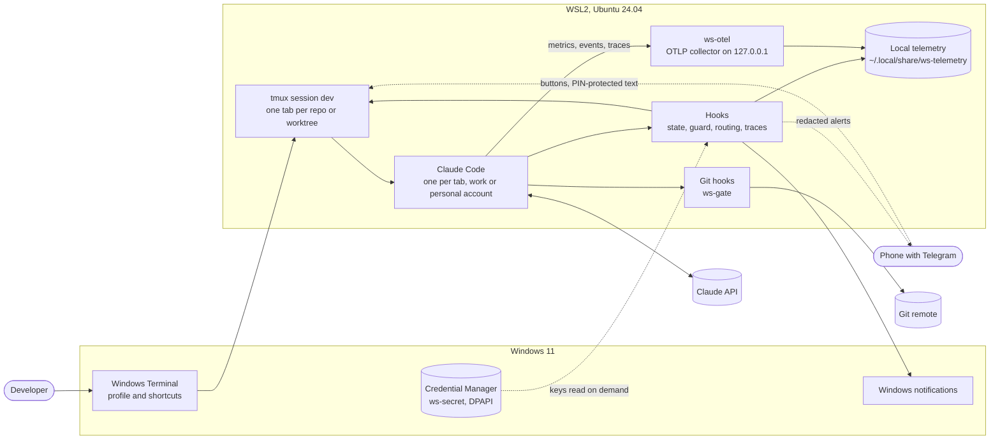

# claude-workstation

[](https://github.com/andreshma/claude-workstation/actions/workflows/ci.yml)
[](https://github.com/andreshma/claude-workstation/actions/workflows/codeql.yml)
[](LICENSE)


A reproducible developer workstation for **WSL2** that runs many **Claude Code** sessions in **tmux**: one tab per
repository or worktree, per-tab agent state with timing, model routing, local telemetry and reports, remote control
over Telegram, protection levels per tab, two Claude accounts side by side and parallel agents in git worktrees.

The repository **captures the real configuration** of one machine (`export.sh`) and **reinstalls it without
clobbering** on another (`install.sh`): every file that changes is copied first to
`~/.local/share/ws-kit/backup.<date>/`.

> **No secrets, no personal data, no company names.** Keys live in the Windows Credential Manager; personal paths are
> exported as templates; the standards the kit installs are generic. Telemetry stays on your machine. See
> [SECURITY.md](SECURITY.md) and the [threat model](docs/THREAT_MODEL.md).

> **Language.** Everything is in English: the interface (menus, status labels, messages), the commands, options and
> stored values, the code comments and the documentation. `ws-lang es` also recognizes prompts typed in Spanish
> ([Language](docs/USAGE.md#15-language)). Version 3.0 renamed the Spanish command names of 2.x: see
> [Upgrading from 2.x names](docs/USAGE.md#18-upgrading-from-2x-names).

## Contents

- [Why](#why)
- [Quickstart](#quickstart)
- [How it works](#how-it-works)
- [Components](#components)
- [Usage](#usage)
- [Telemetry and reports](#telemetry-and-reports)
- [Configuration](#configuration)
- [Security model](#security-model)
- [Testing](#testing)
- [Status](#status)
- [Documentation](#documentation)
- [Community](#community)
- [License](#license)

## Why

Running one Claude Code session is easy. Running ten of them across repositories, all day, raises problems a bare
terminal does not solve:

| Problem | What the workstation does |
|---|---|
| You cannot tell which session is waiting for you | The status bar shows each tab's state and for how long (thinking, running a tool, waiting for approval, "👉 waiting for you" when Claude ended its turn asking you something, done). `Ctrl+b a` lists the active tabs across groups; the menu jumps to the next tab that is waiting |
| Sessions die with the terminal or a reboot | tmux-resurrect and continuum save every minute and on every structural change; Claude resumes its conversation in each restored tab |
| Every task runs on the most expensive model | A routing hook suggests a model per task and asks before switching |
| Nobody knows what the usage looks like | Local telemetry: cost, tokens, words, API latency and errors, tool and hook timings, CPU, RAM and disk per project, weekly trends and estimation ratios |
| An agent can run anything | A sandbox, allow/ask/deny rules, a guard hook and a commit gate; protection levels per tab, with a minimum floor that no level turns off |
| Work and personal usage get mixed | Two Claude accounts on the same workstation, switchable per tab and pinned per project |
| A new machine takes days to set up | `install.sh` reproduces the setup; `ws-test` checks the installed result in an isolated home |

## Quickstart

Requirements: Windows 11 with WSL2 (Ubuntu 24.04), tmux 3.3 or newer, and Claude Code installed and logged in.

```bash
# 1. Base packages (Ubuntu)
sudo apt-get install -y tmux git jq fzf gh bubblewrap socat rsync shellcheck

# 2. The kit
git clone https://github.com/andreshma/claude-workstation ~/code/claude-workstation
cd ~/code/claude-workstation
bash tests/run.sh            # installer tests in temporary homes; they do not touch your machine
bash install.sh --dry-run    # shows new / changed / same without writing
bash install.sh              # detects your Windows user; otherwise pass --win-user

# 3. Tools and health
ws-tools install base cloud quality
# install.sh also points git at the kit hooks (commit gate) unless you already use another hooks path
ws-check && ws-health
```

On Windows, run `windows\install.ps1` from PowerShell to add the terminal profile and shortcuts. Then start the
session with `dev`, press `Ctrl+b I` once to install the tmux plugins, and `Ctrl+b m` to open the menu.

The installer options, the optional packages and the first run are described in
[docs/USAGE.md](docs/USAGE.md#2-install).

## How it works

The diagram shows the workstation, the Windows side it relies on and the three external services it talks to.



Solid arrows are local calls and Claude Code's own traffic; dotted arrows are optional or on-demand paths.

- **Per-tab state.** Claude Code hooks (`tmux-state.sh`) write the phase of each tab into tmux window options;
  `tmux-status` turns it into the label with its elapsed time. `tmux-watch` runs on every status refresh: it counts
  the tabs that wait for you (⚠), the stalled ones (⏳) and the estimated spend per hour (◉), sends Windows
  reminders, and keeps the local OpenTelemetry collector running.
- **Guardrails.** Every tool call passes the PreToolUse hooks (`audit.sh`, `guard.sh`, the runtime gate for the
  emergency stop and the hard spend limit, the memory gate for MemPalace writes), the permission rules and the
  sandbox; web, MCP and network output comes back labelled as untrusted and screened for injection markers; prompts
  are screened for secrets; every commit and push passes `ws-gate`. The flow is drawn in
  [docs/architecture.md](docs/architecture.md#a-tool-call-through-the-gates).
- **Protection levels.** The user settings are a strict base; `tmux-level` restarts Claude in the tab with a
  generated profile (`full`, `normal`, `bare`, or solo mode, which runs inside the sandbox and expires) and resumes
  the conversation. A floor of `deny` rules plus `guard.sh` stays on in every level.
- **Telemetry.** Transcripts, hook traces, resource samples and the local OpenTelemetry collector feed
  `ws-telemetry build`, which renders the dashboard and the data the reports read. Nothing is sent off the machine:
  the exporter endpoints in `~/.claude/settings.json` point to `127.0.0.1:14318`.

The state lifecycle, the guardrail sequence, the protection-level table and the telemetry pipeline are in
[docs/architecture.md](docs/architecture.md); every diagram is also collected in [docs/DIAGRAMS.md](docs/DIAGRAMS.md).

## Components

Everything under `files/home/` is installed into `$HOME`, as listed in `manifest.txt`.

| Component | What it does | Where |
|---|---|---|
| tmux configuration | Tabs, status bar with agent state, menus, themes, tab templates, shell helpers (`tw`, `twt`, `two`, `tp`), account selection for new shells (`accounts.sh`) | `.tmux.conf`, `.config/tmux-claude/` |
| tmux commands | Repository picker, finder (`tmux-find`: tabs, active, favorites, recent), dashboard, state painter (`tmux-status`), watcher (`tmux-watch`), protection levels (`tmux-level`, `tmux-solo`), restart (`tmux-claude-restart`), subagents, focus mode, recording, screensaver (`tmux-saver`, `tmux-art`), summaries | `.local/bin/tmux-*` |
| Workstation commands | Health (`ws-check`, `ws-health`, `ws-verify`, `ws-audit` with `--verify-log` and `--compliance`), backups, tools, the commit gate (`ws-gate`), telemetry and reports (`ws-telemetry`, `ws-report`, `ws-otel`, `ws-hooks`), `ws-cache`, Telegram, secrets and redaction, handoff and learning, the emergency stop (`ws-stop-all`), anomaly detection (`ws-anomaly`), approved memory writes and their review (`ws-memory`), pinned npm packages (`ws-pinned`), the behavior tests (`ws-test`) | `.local/bin/ws-*`, `.local/lib/ws_compliance.py` |
| Accounts and profiles | Per-tab profiles: each tab with its own Claude organisation, Azure tenant and subscription, gh and kubectl logins and, by default, its own conversations and no MemPalace; `work` and `personal` built in | `.local/bin/ws-profile`, `.local/lib/ws-profile.sh`, `.local/bin/claude-account` |
| Claude Code settings and hooks | Model, permissions, sandbox (the strict base), OpenTelemetry export, status line and the hooks: state, audit (hash-chained), guard (fails closed), routing, traces, notifications, lint on edit, document conversion, untrusted-content labelling, prompt secret screen, configuration-change audit, memory gate and `<private>` filter, runtime gate (emergency stop and hard budget) | `.claude/settings.json`, `.claude/hooks/` |
| Level profiles | What the normal level adds to the strict base (the commands excluded from the sandbox); the solo profile | `.config/claude-levels/normal-adds.json`, `.config/claude-solo/settings.json` |
| Guard lists | Credential paths shared by the sandbox and the guard | `.local/lib/ws-credential-paths.txt` |
| Subagents | `architect`, `debugger`, `explorer`, `sql-quick` | `.claude/agents/` |
| Working standards | Generic working standards; your organization's own go in your personal configuration | `.claude/CLAUDE.md`, `.claude/standards.md` |
| Git hooks | A chain that runs `ws-gate` and then each repository's own hooks | `.config/git/hooks/` |
| Prompt | Prompt with folder, branch, Kubernetes, Azure and AWS context; production contexts in red | `.config/starship.toml` |
| Language packs | `ws-lang` selects `en` or `es`; the packs hold the words and expressions the hooks, routing, Telegram and reports recognize in prompts and answers | `.local/bin/ws-lang`, `.local/lib/ws-lang.sh`, `.local/lib/ws-lang/` |
| MCP servers | User-level MCP servers, registered only when the lock vouches for them: npm servers by exact version and sha512, local executables by sha256 on first use, remote ones by URL; `chrome-devtools` is opt-in | `files/mcp-servers.json`, `files/mcp-servers.lock.json`, `.local/lib/ws-npm/` |
| Browser tools (optional) | `agent-browser` behind a wrapper with a domain allow list, an action policy and content boundaries | `.local/bin/agent-browser`, `.config/agent-browser/` |
| Release signers | SSH keys allowed to sign the kit's release tags (`ws-kit-update` installs only signed releases) | `.config/ws-kit/allowed_signers` |
| Managed policy (optional) | A root-owned drop-in with the deny floor and the guard, installed only by `install.sh --managed` | `files/etc/claude-code/managed-settings.json` |
| Installer | Export, install with backups, MCP registration against the lock, the optional managed policy, and the migration of the names used before 3.0 | `export.sh`, `install.sh`, `migrate.sh`, `renames.tsv`, `lib.sh` |
| Compliance and governance | Control catalogue and assessment against the AI and security frameworks; AI use policy, AI bill of materials, AI incident response and review cadence | `docs/compliance/`, `docs/governance/` (repository only, not installed) |
| Windows side | PowerShell profile (`dev`, `devo`…) and installer | `windows/` |

Kept out of the repository on purpose: conversations, audit logs, telemetry, credentials and backups.

## Usage

The full guide is [docs/USAGE.md](docs/USAGE.md). `Ctrl+b` is the tmux prefix: press it, release, then press the key.

| Task | How |
|---|---|
| Enter the session | `dev` in PowerShell, the desktop shortcut or Windows Terminal |
| Open a repository with Claude | `Ctrl+b o` or `tw <folder>` |
| See what needs you | Status bar, `Ctrl+b a` (finder: active now), `Ctrl+b D` (dashboard) |
| Jump to the next tab that waits for you | `Ctrl+b m`, then `g` ("Go to the next one waiting for you or stalled for a while") |
| Move between tabs | `Alt+1…9`, `Alt+←/→`, `Alt+0` (last), `Alt+s` (finder: tabs, active, favorites, recent); `Alt+↑/↓` changes group |
| Open the menu | `Ctrl+b m`; command palette with `Ctrl+b Space` |
| Send a side pane to Claude | `Ctrl+b e` |
| Ask a quick question | `Ctrl+b ?` |
| Pick the model per task | `cr "task"`, or Menu → "Claude in this tab" → "Model" |
| Change the protection level | Menu → "Claude in this tab" → "Protection", or `tmux-level full\|normal\|bare` |
| Switch a tab to the other account | Menu → "Claude in this tab" → "Switch this tab to the … account (same conversation)", or `claude-account tab` |
| Run a tab as one client (Claude organisation, Azure tenant, gh, kubectl) | Menu → "Claude in this tab" → "Profile", or `ws-profile tab NAME` |
| List every shortcut | `Ctrl+b h`; full manual with `ws-menus --show` |

Pinning a project to an account, restarting Claude in every tab, answering from the phone, handing work over to
another Claude and the usage reports are covered in the guide.

## Telemetry and reports

| Command | What you get |
|---|---|
| `ws-telemetry open` | Usage dashboard: today, 7 and 30 days; **trends** (last 7 days against the previous 7, cost per week and project, model mix per week, turn duration, cache and reasoning share, hour-of-day heat map); per project, model, session and tool; resources and network; **API, permissions and active time** from OpenTelemetry; **estimation ratios** |
| `ws-report [--ai]` | 30-day report in HTML and Markdown: what to improve and what to create (rule-based, with evidence), weekly trend, tokens and words, machine resources, an **estimation baseline** per project (active hours, turns, tokens, words, lines, cost per hour), **estimation ratios**, agents, recurring prompts, tools, MCP servers, skills and what Claude has learned about you. `--ai` adds findings written by Claude from the aggregated metrics only |
| `ws-otel status`, `ws-otel summary` | Local OpenTelemetry collector: state, port and signals stored today; counts per signal and event. Also `start`, `stop` |
| `ws-hooks` | Time spent in hooks per event, as measured by Claude Code (needs `ws-otel`). `ws-hooks time SessionStart` runs each hook separately to find the slow one |
| `ws-telemetry estimate` | Active hours, cost, lines and commits per ticket (taken from the branch name) |
| `ws-telemetry week` | Last week against the one before, in Markdown |
| `ws-telemetry budgets` | Monthly budgets per project with projection |
| `ws-telemetry export`, `ws-telemetry sql` | CSV for Excel or Power BI; ad-hoc SQL with DuckDB |

**Estimation ratios** (30 days) are unit rates for projecting work: your words and Claude's words per turn, tokens per
word, model calls and tool calls per turn, output speed, cost per turn, per thousand words, per million tokens and per
active hour, and CPU, disk and RAM per token and per turn. Each ratio states how much data it was computed from.

Costs are API-equivalent prices; a subscription plan does not bill per token. An active turn counts for at most one
hour, so a turn left open does not turn into days of work.

Two kinds of data, with different content rules:

- **Transcript-derived data and hook traces** store counts, timings and names only: no prompt text, no full commands,
  no file contents.
- **The local OpenTelemetry collector** (`ws-otel`, [ADR 0014](docs/adr/0014-local-opentelemetry-collector.md)) stores
  everything Claude Code emits, including prompt, response and tool text, with secrets that are recognizable by their
  shape replaced by `[SECRET]`. Set `WS_OTEL_CONTENT=0` to keep counts, timings and names only.

## Configuration

`export.sh` replaces the exporter's paths and user names with placeholders; `install.sh` replaces them with the values
of the target machine.

| Placeholder | Value |
|---|---|
| `@WINHOME@` | Windows profile as seen from WSL |
| `@WIN_USER@` | Windows user name |
| `@HOME@` | Linux `$HOME` |
| `@LINUX_USER@` | Linux user name |

| Setting | Default | Meaning |
|---|---|---|
| `~/.config/tmux-claude/roots.txt` | Installed by the kit | Repository roots for the picker, one per line as `label\|depth\|path` |
| `~/.config/ws-routing/rules.conf` | Installed by the kit | Routing rules; the first match wins |
| `~/.config/ws-telemetry/prices.json` | Not present; the built-in price table applies | Model prices |
| `~/.config/ws-telemetry/budgets.conf` | Not present | Monthly budgets; a line `hard=1` holds work in a project at 100 % until `ws-telemetry budgets --override` |
| `~/.config/claude-levels/normal-adds.json` | Installed by the kit | What the normal level adds to the strict base: the commands excluded from the sandbox |
| `~/.config/ws-guard/production.conf` | Not present; the name pattern applies alone | Production subscriptions and kube contexts the guard protects, as `subscription <id or name>` and `context <name>` lines |
| `~/.config/ws-guard/allow-config-writes` | Not present | An epoch until which Claude may write `CLAUDE.md`, commands, agents and skills (the owner's 30-minute window); written by you only |
| `~/.config/ws-agent/<name>/` | Not present | The `az`, `gh` and `kubectl` logins of an agent identity (`tmux-level … --agent <name>`) and of the profile `<name>` |
| `~/.config/ws-profiles/` | Not present | Profiles (`<name>/profile.conf`), the one for new tabs (`default`) and the pinned projects (`projects.conf`), written by `ws-profile` |
| `~/.claude-profiles/<name>/` | Not present | The Claude dir of a custom profile (its login and conversations) |
| `~/.config/ws-kit/allowed_signers.local` | Not present | Extra release-signing keys for a fork |
| `~/.config/ws-backup/age-recipients` | Not present | Extra `age` keys the light backup is encrypted to, besides the cloud key |
| `~/.config/agent-browser/allowed-domains.local.txt` | Not present | Domains agent-browser may open besides localhost |
| `~/.config/ws-local/bar-extra.conf` | Not present; not part of the kit | Extra status bar segments |
| `~/.config/claude-accounts/active`, `projects.conf` | Not present | Before the profiles; `install.sh` copies them into `~/.config/ws-profiles/` once |
| `~/.config/tmux-claude/appearance` | Screensaver on, random scene, 10 minutes | Theme and screensaver preferences |
| `~/.config/tmux-claude/gallery` | Not present | Screensaver images |
| `~/.config/tmux-claude/lang` | `en`; `es` on an installation migrated from 2.x | Language of the prompts and answers the kit recognizes, and the language Claude writes reports in (written by `ws-lang`; `WS_LANG` overrides it) |
| Secrets | Windows Credential Manager | Stored through `ws-secret`; never files or exported variables |

Environment variables and tmux options are listed in [docs/USAGE.md](docs/USAGE.md#19-command-reference).

### Two Claude accounts

`claude-account` keeps a work account (`work`, in `~/.claude`) and a personal one (in `~/.claude-personal`, selected
with `CLAUDE_CONFIG_DIR`). Each has its own login; both share settings, hooks, agents, conversations and history, so
switching a tab keeps the same conversation.

```bash
claude-account setup                      # once: prepares ~/.claude-personal
claude-account login personal             # logs in to the personal account
claude-account use work|personal          # account for new tabs
claude-account tab                        # switches the current tab to the other account
claude-account project personal ~/code/x  # pins a repository (and its worktrees) to an account
claude-account projects                   # lists pinned projects
claude-account status                     # default account, organization of each, pinned projects
```

A pinned project wins over the default account: every new tab opened there uses the pinned account.

### Profiles: one client per tab

For clients with their own Azure tenant or Claude organisation, `ws-profile` adds a profile per client: its own
Claude login, Azure tenant and default subscription, `gh` and `kubectl` logins and, by default, its own conversations
and no MemPalace, so one client's data does not flow into another's organisation
([ADR 0021](docs/adr/0021-per-tab-profiles.md)). `work` and `personal` above are its built-in profiles.

```bash
ws-profile new contoso --tenant 00000000-0000-0000-0000-00000000c001   # in a terminal: asks for each login
ws-profile project contoso ~/code/contoso-app                          # that repo always opens as contoso
ws-profile tab contoso                                                 # this tab, now (Menu → Claude → Profile)
ws-profile list                                                        # profiles; ws-profile status for the logins
```

The tab shows `⬢contoso` in the status bar. The agent cannot read any profile's logins, read another profile's
conversations, change the tab's profile or log in. Details in [docs/USAGE.md](docs/USAGE.md#profiles-several-organisations-and-tenants).

### Personal configuration

Personal configuration (status bar segments, budgets, routing and Telegram settings, your own templates, your
organization's standards) does not belong in this kit. `ws-personal` keeps it in a separate private repository
([ADR 0011](docs/adr/0011-personal-configuration.md)):

```bash
ws-personal init --github     # once: creates the private repository and pushes it
ws-personal add .config/something/mine.conf
ws-personal restore           # on a new PC, after install.sh
```

## Security model

The full analysis, with residual risks, is in [docs/THREAT_MODEL.md](docs/THREAT_MODEL.md); how the kit stands
against the AI and security frameworks is in [docs/compliance/assessment.md](docs/compliance/assessment.md).

- **Secrets** live only in the Windows Credential Manager (`ws-secret`). `export.sh` refuses to export anything that
  looks like a secret; gitleaks runs in the commit gate, where a missing gitleaks now blocks the commit, and in CI.
  Prompts that seem to carry a secret are stopped before they are sent (`#allow-secret` overrides, audited).
- **A strict base with levels that add** ([ADR 0019](docs/adr/0019-strict-base-and-level-profiles.md)): the user
  settings run every command inside the sandbox, which denies reading credential folders; the normal level adds the
  commands that need network and credentials; enumerated read-only commands are allowed; cloud, database,
  infrastructure, container, Windows `.exe` and memory-write actions ask first; reading secrets and bypassing the git
  gate are denied; `bypassPermissions` mode is disabled.
- **A floor that no protection level turns off** ([ADR 0013](docs/adr/0013-minimum-protection-floor.md)): the `deny`
  rules and `guard.sh`, which fails closed (`onFailure: block`, also when the hook itself is missing). The guard
  blocks forced pushes and pushes to `main`/`master`, `--no-verify`, changes to `core.hooksPath` and `ws.gate.*`,
  `Co-authored-by` trailers, download-and-execute, `ws-secret get`, `gh auth token`, mutating `az`,
  `kubectl`, `helm` and Azure MCP calls against production (by name or listed in `production.conf`), writing secrets
  into files, naming a credential store in a command, and the agent writing its own configuration: settings, hooks,
  `~/.claude.json`, plugins, level profiles, git hooks, the kit's update keys and pinned packages, the audit log, and
  `CLAUDE.md`, commands, agents and skills outside a 30-minute window the owner opens
  ([ADR 0017](docs/adr/0017-defence-in-depth-for-agent-configuration.md)). Registering MCP servers and plugins from
  Claude is denied. `install.sh --managed` can also install the floor as a root-owned managed policy. Each
  repository's own `.claude/settings*.json` still applies; `ws-audit` warns when one widens every level.
- **Untrusted content.** Web fetches, searches, MCP results and network commands come back labelled as untrusted data
  and screened for injection markers (a heuristic; hits are audited). Memory writes ask every time, carry a
  provenance stamped by the hook, and never contain text marked `<private>`.
- **Solo mode inside the sandbox** ([ADR 0016](docs/adr/0016-solo-mode-inside-the-sandbox.md)): auto mode with the
  sandbox on and a 4-hour expiry; the unsandboxed variant is an audited exception. Swarm agents run at the `full`
  level with `git push` denied.
- **Containment and evidence.** `ws-stop-all` blocks every prompt and tool call in every Claude, closes them and turns
  Telegram off; `ws-anomaly` flags sessions with repeated blocks or denials; the audit log is a hash chain with
  anchors on the Windows side (`ws-audit --verify-log`), kept 395 days. Agent identities (`--agent`) give a tab its
  own cloud and git logins ([ADR 0020](docs/adr/0020-agent-scoped-identities.md)).
- **Commit gate** (`ws-gate`): secrets, lint, Conventional Commits, dependencies and infrastructure-as-code checks on
  commit and push.
- **Telemetry is local.** Hook traces hold no prompt text. The local OpenTelemetry collector does keep content on disk
  (the owner's choice, ADR 0014), with recognizable secrets masked and files readable only by the user. Text that
  leaves the machine through the kit's own channels (Telegram messages, panes pasted into Claude, handoff summaries)
  is redacted first with `ws-redact`. Light backups are encrypted with `age` by default.
- **Telegram control** answers only the owner's chat, with one-time codes that expire in 10 minutes. Approving a risky
  dialog needs the PIN, and "don't ask again" is never offered. ▶ Run is offered only for read-only commands of an
  allow list, with the PIN, and never in `bare` or solo-mode tabs. Free-text replies are off by default and require
  the PIN.
- **Supply chain** ([ADR 0018](docs/adr/0018-supply-chain-pinning-and-signed-releases.md)): MCP servers and agent
  tools are pinned by version and integrity (`ws-pinned`, no `npx -y`); `ws-kit-update` installs only release tags
  signed by a key in `allowed_signers`; CI uses only GitHub's own actions, pinned by commit SHA and checked by zizmor;
  gitleaks and zizmor are downloaded at pinned versions and verified by checksum; a CycloneDX SBOM is built in CI and
  attached to each release; `ws-tools` installs from apt, pipx or GitHub releases verified against their checksum;
  Dependabot watches the workflows and the pinned npm packages.
- **Governance**: an AI use policy, an AI bill of materials, AI incident-response playbooks and a review cadence in
  [docs/governance/](docs/governance/README.md); `ws-audit --compliance` and the CI compliance checks keep the
  control catalogue honest.

Report vulnerabilities privately as described in [SECURITY.md](SECURITY.md).

## Testing

Details in [docs/TESTING.md](docs/TESTING.md).

| Command | Scope |
|---|---|
| `bash tests/run.sh` | Installer and exporter in temporary homes (templates, secret blocking, backups, idempotence, migration of the names used before 3.0), JSON and shellcheck of the payload, and the guard tests |
| `bash tests/guard.sh` | The PreToolUse guard: bypass variants, protected configuration, credential paths, production list, agent identity and profiles, false positives and fail-closed behavior |
| `bash tests/<area>.sh` | The other standalone suites (twenty-one with the two above): hooks, audit chain and anomalies, memory gate, spend and stop gate, solo sandbox, per-tab profiles, supply chain and signed updates, Telegram approvals, backup encryption, gate secret scan, Windows interop, and the compliance catalogue and AI-BOM checks |
| `ws-test` | Behavior of the **installed** workstation, with an isolated home, isolated tmux sockets and a simulated Claude; costs no usage |
| `ws-test --ai` | The same plus non-deterministic checks against the real Claude |
| `ws-verify` | Read-only verification before pushing: scripts, tmux (also the running server: `--live`), Claude Code settings, the kit and the tests |

CI runs lint (shellcheck, Python compile, JSON, tmux syntax), SAST and secret scanning (bandit, gitleaks), workflow
security (zizmor), the SBOM, `tests/run.sh`, every other `tests/*.sh` suite, and a clean install followed by
`ws-test` on every push to `main` and every pull request. CodeQL analyzes the Python scripts and the workflows. A
signed release tag runs `release.yml`; a monthly workflow re-checks the compliance catalogue, the AI-BOM and the
framework editions.

## Status

Beta, used daily by its author on Windows 11 with WSL2 (Ubuntu 24.04), tmux 3.4 and Claude Code 2.1. Versions follow
[SemVer](https://semver.org/); changes are recorded in [CHANGELOG.md](CHANGELOG.md).

Known limits:

- Windows with WSL2 only.
- Version 3.0 is a breaking release: commands, options, environment variables, folders and stored values were renamed
  from Spanish to English. The installer migrates an existing installation and leaves wrappers under the old command
  names until the next major version; scripts and spreadsheets that use the old subcommands, options or CSV and JSON
  keys must be updated ([Upgrading from 2.x names](docs/USAGE.md#18-upgrading-from-2x-names)).
- The interface is English only; `ws-lang` selects which languages are recognized in prompts, not the language of the
  menus ([ADR 0015](docs/adr/0015-english-names-and-language-selector.md)).
- Hook-based traces and OpenTelemetry data exist only from the day the workstation is installed, while cost and token
  history is rebuilt from the transcripts Claude Code keeps.
- OpenTelemetry traces are a beta feature of Claude Code and may change.

Roadmap pointers: the open controls and the plan are in [docs/compliance/assessment.md](docs/compliance/assessment.md);
the residual risks and pending work are in the [threat model](docs/THREAT_MODEL.md#pending-work).

## Documentation

| Document | What it answers |
|---|---|
| [docs/USAGE.md](docs/USAGE.md) | How to install and use the workstation day to day: key bindings, menu map, status bar legend, accounts, protection levels, reports |
| [docs/architecture.md](docs/architecture.md) | What the components are, how they fit, what state they keep and which rules must not be broken |
| [docs/DIAGRAMS.md](docs/DIAGRAMS.md) | Every diagram in one place |
| [docs/TESTING.md](docs/TESTING.md) | Which test suites exist, what each covers and how CI runs them |
| [docs/THREAT_MODEL.md](docs/THREAT_MODEL.md) | Which assets, trust boundaries, threats, controls, residual risks and pending work exist |
| [docs/runbook.md](docs/runbook.md) | How to operate, upgrade and recover the workstation, step by step |
| [docs/adr/](docs/adr/README.md) | Which architecture decisions were made and why; the latest is [0020](docs/adr/0020-agent-scoped-identities.md), agent-scoped identities |
| [docs/compliance/](docs/compliance/assessment.md) | How the kit stands against the AI and security frameworks: the framework list ([frameworks.md](docs/compliance/frameworks.md)), the control catalogue ([controls.yaml](docs/compliance/controls.yaml)) and the assessment with coverage and plan |
| [docs/governance/](docs/governance/README.md) | Which rules govern AI use on the workstation: the AI use policy, the AI bill of materials, AI incident response and the review cadence |
| [CHANGELOG.md](CHANGELOG.md) | What changed in each release (Keep a Changelog) |
| [CONTRIBUTING.md](CONTRIBUTING.md) | How to set up, change, test and document a contribution |
| [CODE_OF_CONDUCT.md](CODE_OF_CONDUCT.md) | Which behavior is expected and how to report a problem |
| [GOVERNANCE.md](GOVERNANCE.md) | Who decides, how changes are merged and how releases are cut |
| [SECURITY.md](SECURITY.md) | Which versions are supported and how to report a vulnerability |
| [SUPPORT.md](SUPPORT.md) | Where to ask for help |

## Community

- Questions and ideas: [Discussions](https://github.com/andreshma/claude-workstation/discussions)
- Bugs and feature requests: [Issues](https://github.com/andreshma/claude-workstation/issues)
- How to contribute: [CONTRIBUTING.md](CONTRIBUTING.md), [CODE_OF_CONDUCT.md](CODE_OF_CONDUCT.md),
  [GOVERNANCE.md](GOVERNANCE.md), [SUPPORT.md](SUPPORT.md), [SECURITY.md](SECURITY.md)
- Citing the project: [CITATION.cff](CITATION.cff)

Commits follow [Conventional Commits](https://www.conventionalcommits.org/) in the imperative mood, one logical change
per commit, without `Co-authored-by` trailers.

## License

[Apache-2.0](LICENSE). Third-party tools the workstation installs (tmux, fzf, ble.sh, starship, gitleaks, Claude Code
and others) remain under their own licenses; see [NOTICE](NOTICE).
