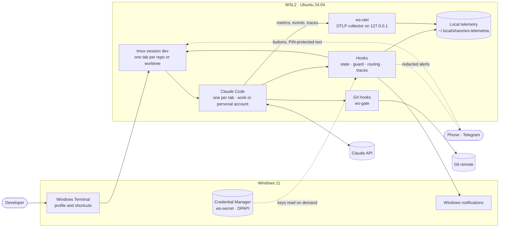
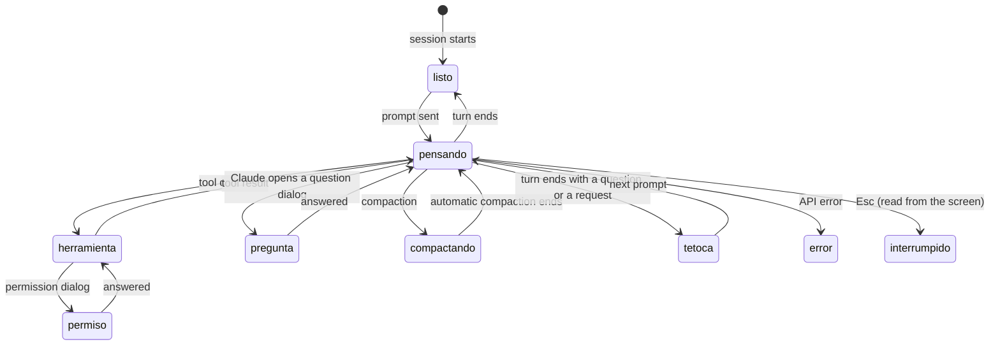
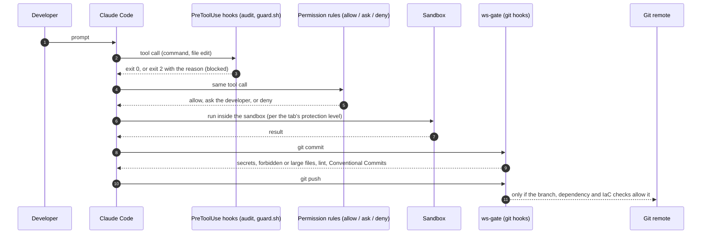
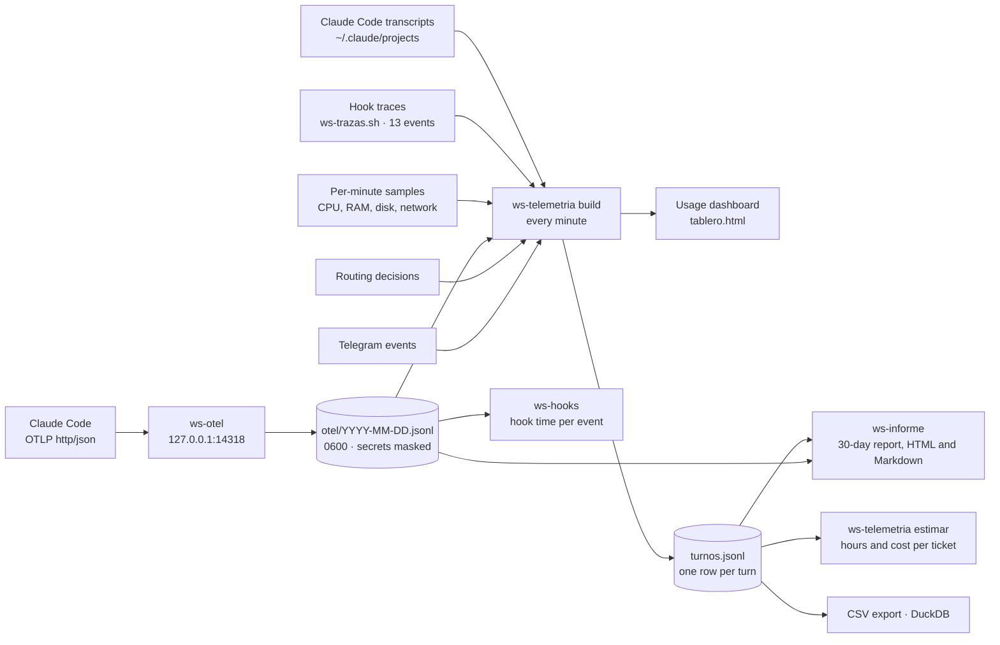

# claude-workstation

[](https://github.com/andreshma/claude-workstation/actions/workflows/ci.yml)
[](https://github.com/andreshma/claude-workstation/actions/workflows/codeql.yml)
[](LICENSE)


A reproducible developer workstation for **WSL2** that runs many **Claude Code** sessions in **tmux**: one tab per
repository or worktree, per-tab agent state with timing, model routing, local telemetry and reports, remote control
over Telegram, protection levels per tab, two Claude accounts side by side and parallel agents in git worktrees.

The repository **captures the real configuration** of one machine (`export.sh`) and **reinstalls it without
clobbering** on another (`install.sh`): every file that changes is backed up first as `*.bak.<date>`.

> **No secrets, no personal data, no company names.** Keys live in the Windows Credential Manager; personal paths are
> exported as templates; the standards the kit installs are generic. Telemetry stays on your machine. See
> [SECURITY.md](SECURITY.md) and the [threat model](docs/THREAT_MODEL.md).

> **Language.** This README, the documents under `docs/` and the community files are in English. The workstation's
> user interface (menus, status labels, messages, command names) is in **Spanish** on purpose; labels are quoted here
> as the screen shows them. A shorter Spanish README is kept at [docs/README.es.md](docs/README.es.md).

## Contents

- [Why](#why)
- [Quickstart](#quickstart)
- [How it works](#how-it-works)
- [Components](#components)
- [Daily use](#daily-use)
- [Telemetry and reports](#telemetry-and-reports)
- [Configuration](#configuration)
- [Security model](#security-model)
- [Testing and CI](#testing-and-ci)
- [Maintenance and runbook](#maintenance-and-runbook)
- [Status](#status)
- [Documentation](#documentation)
- [Community](#community)
- [License](#license)

## Why

Running one Claude Code session is easy. Running ten of them across repositories, all day, raises problems a bare
terminal does not solve:

| Problem | What the workstation does |
|---|---|
| Which session is waiting for me? | The status bar shows each tab's state and for how long (thinking, running a tool, waiting for approval, «👉 te toca» when Claude ended its turn asking you something, done). `Ctrl+b a` lists the active tabs across groups; the menu jumps to the next tab that is waiting |
| Sessions die with the terminal or a reboot | tmux-resurrect and continuum save every minute and on every structural change; Claude resumes its conversation in each restored tab |
| Every task runs on the most expensive model | A routing hook suggests a model per task and asks before switching |
| Nobody knows what the usage looks like | Local telemetry: cost, tokens, words, API latency and errors, tool and hook timings, CPU, RAM and disk per project, weekly trends and estimation ratios |
| An agent can run anything | A sandbox, allow/ask/deny rules, a guard hook and a commit gate; protection levels per tab, with a minimum floor that no level turns off |
| Work and personal usage get mixed | Two Claude accounts on the same station, switchable per tab and pinned per project |
| A new machine takes days to set up | `install.sh` reproduces the setup; `ws-test` checks the installed result in an isolated home |

## Quickstart

Requirements: Windows 11 with WSL2 (Ubuntu 24.04), tmux 3.3 or newer, and Claude Code installed and logged in.

```bash
# 1. Base packages (Ubuntu)
sudo apt-get install -y tmux git jq fzf gh bubblewrap socat rsync shellcheck

# 2. The kit
git clone https://github.com/andreshma/claude-workstation ~/code/claude-workstation
cd ~/code/claude-workstation
bash tests/run.sh            # installer tests in temporary homes; they do not touch your machine
bash install.sh --dry-run    # shows new / changed / unchanged without writing
bash install.sh              # detects your Windows user; otherwise pass --win-user

# 3. Tools and health
ws-tools install base nube calidad
# install.sh also points git at the kit hooks (commit gate) unless you already use another hooks path
ws-check && ws-health
```

On Windows, run `windows\instalar.ps1` from PowerShell to add the terminal profile and shortcuts. Then start the
session with `dev`, press `Ctrl+b I` once to install the tmux plugins, and `Ctrl+b m` to open the menu.

Optional packages: `python3-numpy` (12 of the 25 screensaver scenes use a numpy shading engine) and `chafa` (the
`galeria` screensaver scene). `ws-tools install numpy chafa` installs both.

`install.sh` options:

| Option | Use |
|---|---|
| `--dry-run` | Print what would change without writing |
| `--win-user USER` | Windows user name, when it cannot be detected |
| `--repos PATH` | Folder that holds your repositories (default: `source/repos` under the Windows profile) |
| `--no-plugins` · `--no-mcp` | Skip tmux plugins · skip MCP server registration |

## How it works

The full component description is in [docs/architecture.md](docs/architecture.md).

### System context



### Per-tab state

Claude Code hooks (`tmux-state.sh`) write the phase of each tab into tmux window options; `tmux-estado` turns it into
the label with its elapsed time. Not every transition fires a hook (pressing `Esc`, for example), so after 15 seconds
without events the label is checked against what the pane actually shows.



| Phase | Label in the bar | Meaning |
|---|---|---|
| `pensando` | 🧠 pensando 42s | Claude is thinking |
| `herramienta` | 🔧 Bash 2m | A tool is running |
| `permiso` | ✋ aprobar Bash 5m | A permission dialog is open |
| `pregunta` | ❓ te pregunta 1m | Claude opened a question dialog |
| `tetoca` | 👉 te toca 3m | The turn ended and the last message asks you something or asks you to do something (`WS_TETOCA=0` turns it off) |
| `compactando` | 📦 compactando | The conversation is being compacted |
| `listo` | ✔ listo hace 12m | The turn ended with nothing pending |
| — | 🐝 3 agentes 4m · ⏳ sin avance 11m | Subagents running · no events for `@cwatch_stall` minutes (10) |
| `interrumpido` · `error` | ⛔ interrumpido · ✖ error API | Interrupted · API error |

`tmux-watch` runs on every status refresh: it counts the tabs that wait for you (⚠, which includes «te toca»), the
stalled ones (⏳), the estimated spend per hour (◉), sends Windows reminders, and keeps the local OpenTelemetry
collector running.

### Guardrails on every command and commit



### Protection levels per tab

`tmux-nivel` restarts Claude in the tab with the chosen level and resumes the conversation. The bar shows 🔒 for
`completo` and 🔓 for `puro`.

| Level | Sandbox | Kit `allow` / `ask` rules | Floor: `deny` rules + `guard.sh` | Use it for |
|---|---|---|---|---|
| **Full** (`completo`) 🔒 | On, no unsandboxed commands and no excluded commands (`az`, `gh`, `git push`, `kubectl`… stay inside and mostly fail) | On | On | Untrusted repositories, risky changes |
| **Normal** | On, with the excluded commands of `~/.claude/settings.json` | On | On | Daily work |
| **Pure** (`puro`) 🔓 | Off | Off (Claude asks as it would without the kit) | On | Comparing against stock Claude Code |
| **Solo mode** (`modo solo`) 🤖 | Off | On; Claude runs in `auto` permission mode | On | Leaving Claude to work alone on a task |

The floor is the part no level turns off ([ADR-013](docs/adr/0013-minimum-protection-floor.md)): the `deny` rules
(credential files, `ws-secret get`, cloud keys and connection strings, bypassing the git gate) and the `guard.sh`
PreToolUse hook, which fails closed. Hooks that do not restrict anything (state, traces, notifications) also stay on in
every level. Organization-managed settings and each repository's own `.claude/settings*.json` always apply. The
original design is in [ADR-012](docs/adr/0012-per-tab-protection.md); phase 2 of ADR-013 is still pending and is listed
in the [threat model](docs/THREAT_MODEL.md#pending-work).

### Telemetry pipeline



Two kinds of data, with different content rules:

- **Transcript-derived data and hook traces** store counts, timings and names only: no prompt text, no full commands,
  no file contents.
- **The local OpenTelemetry collector** (`ws-otel`, [ADR-014](docs/adr/0014-local-opentelemetry-collector.md)) stores
  everything Claude Code emits, including prompt, response and tool text, with secrets that are recognizable by their
  shape replaced by `[SECRETO]`. Set `WS_OTEL_CONTENIDO=0` to keep counts, timings and names only.

Nothing is sent off the machine: the exporter endpoints in `~/.claude/settings.json` point to `127.0.0.1:14318`.

## Components

Everything under `files/home/` is installed into `$HOME`, as listed in `manifest.txt`.

| Path | What it is |
|---|---|
| `.tmux.conf`, `.config/tmux-claude/` | Tabs, status bar with agent state, menus, themes, tab templates, shell helpers (`tw`, `twt`, `two`, `tp`), account selection for new shells (`cuentas.sh`) |
| `.local/bin/tmux-*` | Repository and tab pickers, dashboard, active view, state painter (`tmux-estado`), watcher (`tmux-watch`), protection levels (`tmux-nivel`, `tmux-solo`), restart (`tmux-claude-restart`), subagents, focus mode, recording, screensaver (`tmux-saver`, `tmux-arte`), summaries |
| `.local/bin/ws-*` | Health (`ws-check`, `ws-health`, `ws-verify`, `ws-auditoria`), backups, tools, the commit gate (`ws-gate`), telemetry and reports (`ws-telemetria`, `ws-informe`, `ws-otel`, `ws-hooks`), `ws-cache`, Telegram, secrets and redaction, handoff and learning, the behavior tests (`ws-test`) |
| `.local/bin/claude-cuenta` | Two Claude accounts (`trabajo` = work, `personal`), per tab and per project |
| `.claude/settings.json`, `.claude/hooks/` | Model, permissions, sandbox, OpenTelemetry export, status line and the hooks: state, audit, guard, routing, traces, notifications, lint on edit, document conversion |
| `.claude/agents/` | Subagents: `arquitecto`, `depurador`, `explorador`, `sql-rapido` |
| `.claude/CLAUDE.md`, `.claude/estandares.md` | Generic working standards; your organization's own go in your personal configuration |
| `.config/git/hooks/` | A chain that runs `ws-gate` and then each repository's own hooks |
| `.config/starship.toml` | Prompt with folder, branch, Kubernetes, Azure and AWS context; production contexts in red |
| `files/mcp-servers.json` | User-level MCP servers; those whose executable is missing are skipped with a warning |
| `windows/` | PowerShell profile (`dev`, `devo`…) and installer |

Kept out of the repository on purpose: conversations, audit logs, telemetry, credentials and backups.

## Daily use

The full guide is [docs/USAGE.md](docs/USAGE.md).

| I want to | How |
|---|---|
| Enter the session | `dev` in PowerShell, the desktop shortcut or Windows Terminal |
| Open a repository with Claude | `Ctrl+b o` · `tw <folder>` |
| See what needs me | Status bar · `Ctrl+b a` (active now) · `Ctrl+b D` (dashboard) |
| Jump to the next tab that waits for me | `Ctrl+b m`, then `g` («Ir a la siguiente que te espera o lleva rato sin avance») |
| Move between tabs | `Alt+1…9`, `Alt+←/→`, `Alt+0` (last), `Alt+s` (search); `Alt+↑/↓` changes group |
| Open the menu | `Ctrl+b m` · command palette with `Ctrl+b Space` |
| Send a side pane to Claude | `Ctrl+b e` |
| Ask a quick question | `Ctrl+b ?` |
| Pick the model per task | `cr "task"` · Menu → «Claude en esta pestaña» → «Modelo» |
| Change the protection level | Menu → «Claude en esta pestaña» → «Protección» · `tmux-nivel completo\|normal\|puro` |
| Switch a tab to the other account | Menu → «Claude en esta pestaña» → «Cambiar esta pestaña a cuenta…» · `claude-cuenta pestaña` |
| Pin a project to an account | `claude-cuenta proyecto trabajo\|personal [folder]` |
| Restart Claude everywhere after a config change | Menu → «Estación» → «Reiniciar Claude en todas las pestañas libres» · `tmux-claude-restart --todas` |
| Answer Claude from the phone | `ws-telegram configurar` once, then the buttons in Telegram |
| Hand work over to another Claude | Menu → «Claude en esta pestaña» → «Exportar mi trabajo para otro Claude» (`ws-traspaso`) |
| See usage | Menu → «Consumo e informes» |
| List every shortcut | `Ctrl+b h` · full manual with `ws-menus --ver` |

Restarting Claude in all tabs skips the tabs that are working or have a dialog open, keeps each tab's protection
level and leaves solo-mode tabs alone; `--lista` shows what it would do and `--tambien-ocupadas` includes busy tabs.

Session start does not wait for slow hooks: the SessionStart hooks that take seconds run through `ws-cache`, which
returns the last result at once and refreshes it in the background (a result older than `--max` seconds is not
trusted and the hook is run and awaited).

The screensaver (`tmux-saver`) appears after 10 idle minutes and any key dismisses it. All scenes are drawn by
`tmux-arte`: 25 animated ASCII scenes, 12 of which use a numpy-based shading engine. A `galeria` scene shows your own
images and GIFs from `~/.config/tmux-claude/galeria` through `chafa`.

## Telemetry and reports

| Command | What you get |
|---|---|
| `ws-telemetria abrir` | Usage dashboard: today, 7 and 30 days; **trends** (last 7 days against the previous 7, cost per week and project, model mix per week, turn duration, cache and reasoning share, hour-of-day heat map); per project, model, session and tool; resources and network; **API, permissions and active time** from OpenTelemetry; **estimation ratios** |
| `ws-informe [--ia]` | 30-day report in HTML and Markdown: what to improve and what to create (rule-based, with evidence), weekly trend, tokens and words, machine resources, an **estimation baseline** per project (active hours, turns, tokens, words, lines, cost per hour), **estimation ratios**, agents, recurring prompts, tools, MCP servers, skills and what Claude has learned about you. `--ia` adds findings written by Claude from the aggregated metrics only |
| `ws-otel estado` · `resumen` | Local OpenTelemetry collector: state, port and signals stored today · counts per signal and event. Also `iniciar`, `detener` |
| `ws-hooks` | Time spent in hooks per event, as measured by Claude Code (needs `ws-otel`). `ws-hooks tiempo SessionStart` runs each hook separately to find the slow one |
| `ws-telemetria estimar` | Active hours, cost, lines and commits per ticket (taken from the branch name) |
| `ws-telemetria semana` | Last week against the one before, in Markdown |
| `ws-telemetria presupuestos` | Monthly budgets per project with projection |
| `ws-telemetria exportar` · `sql` | CSV for Excel or Power BI · ad-hoc SQL with DuckDB |

**Estimation ratios** (30 days) are unit rates for projecting work: your words and Claude's words per turn, tokens per
word, model calls and tool calls per turn, output speed, cost per turn, per thousand words, per million tokens and per
active hour, and CPU, disk and RAM per token and per turn. Each ratio states how much data it was computed from.

Costs are API-equivalent prices; a subscription plan does not bill per token. An active turn counts for at most one
hour, so a turn left open does not turn into days of work.

## Configuration

`export.sh` replaces the exporter's paths and user names with placeholders; `install.sh` replaces them with the values
of the target machine.

| Placeholder | Value |
|---|---|
| `@WINHOME@` | Windows profile as seen from WSL |
| `@WIN_USER@` | Windows user name |
| `@HOME@` | Linux `$HOME` |
| `@LINUX_USER@` | Linux user name |

| Setting | Where |
|---|---|
| Repository roots for the picker | `~/.config/tmux-claude/roots.txt` |
| Routing rules | `~/.config/ws-ruteo/reglas.conf` |
| Model prices | `~/.config/ws-telemetria/precios.json` |
| Monthly budgets | `~/.config/ws-telemetria/presupuestos.conf` |
| Extra status bar segments | `~/.config/ws-local/barra-extra.conf` |
| Account for new tabs · accounts pinned per project | `~/.config/claude-cuentas/activa` · `proyectos.conf` (written by `claude-cuenta`) |
| Theme and screensaver preferences | `~/.config/tmux-claude/apariencia` |
| Screensaver images | `~/.config/tmux-claude/galeria` |
| Secrets | Windows Credential Manager through `ws-secret` (never files or exported variables) |

### Two Claude accounts

`claude-cuenta` keeps a work account (`trabajo`, in `~/.claude`) and a personal one (in `~/.claude-personal`, selected
with `CLAUDE_CONFIG_DIR`). Each has its own login; both share settings, hooks, agents, conversations and history, so
switching a tab keeps the same conversation.

```bash
claude-cuenta setup                      # once: prepares ~/.claude-personal
claude-cuenta login personal             # logs in to the personal account
claude-cuenta usar trabajo|personal      # account for new tabs
claude-cuenta pestaña                    # switches the current tab to the other account
claude-cuenta proyecto personal ~/code/x # pins a repository (and its worktrees) to an account
claude-cuenta proyectos                  # lists pinned projects
claude-cuenta estado                     # default account, organization of each, pinned projects
```

A pinned project wins over the default account: every new tab opened there uses the pinned account.

### Personal configuration

Personal configuration (status bar segments, budgets, routing and Telegram settings, your own templates, your
organization's standards) does not belong in this kit. `ws-personal` keeps it in a separate private repository
([ADR-011](docs/adr/0011-personal-configuration.md)):

```bash
ws-personal init --github     # once: creates the private repository and pushes it
ws-personal agregar .config/something/mine.conf
ws-personal restaurar         # on a new PC, after install.sh
```

## Security model

The full analysis, with residual risks, is in [docs/THREAT_MODEL.md](docs/THREAT_MODEL.md).

- **Secrets** live only in the Windows Credential Manager (`ws-secret`). `export.sh` refuses to export anything that
  looks like a secret, and gitleaks runs in the commit gate and in CI.
- **Claude Code runs with least privilege**: a sandbox that denies reading credential folders; enumerated read-only
  commands are allowed; cloud, database, infrastructure and container changes ask first; reading secrets and bypassing
  the git gate are denied.
- **A floor that no protection level turns off** (ADR-013): the `deny` rules and `guard.sh`. The guard blocks forced
  pushes and pushes to `main`/`master`, `--no-verify`, changes to `core.hooksPath` and `ws.gate.*`, `Co-authored-by`
  trailers, download-and-execute, `ws-secret get`, mutating `az`, `kubectl` and `helm` commands against production,
  and writing secrets into files. It fails closed when it cannot read the action.
- **Commit gate** (`ws-gate`): secrets, lint, Conventional Commits, dependencies and infrastructure-as-code checks on
  commit and push.
- **Telemetry is local.** Hook traces hold no prompt text. The local OpenTelemetry collector does keep content on disk
  (the owner's choice, ADR-014), with recognizable secrets masked and files readable only by the user. Text that leaves
  the machine through the kit's own channels (Telegram messages, panes pasted into Claude, handoff summaries) is
  redacted first with `ws-redactar`.
- **Telegram control** answers only the owner's chat, with one-time codes that expire in 10 minutes. Free-text replies
  are off by default and require a PIN. Commands proposed by Claude are never offered or run in tabs without a sandbox
  (`puro` or solo mode) and are checked against two block lists.
- **Supply chain**: CI uses only GitHub's own actions; gitleaks is downloaded at a pinned version and verified by
  checksum; `ws-tools` installs from apt, pipx or GitHub releases verified against their checksum; Dependabot watches
  the workflows.

Report vulnerabilities privately as described in [SECURITY.md](SECURITY.md).

## Testing and CI

Details in [docs/TESTING.md](docs/TESTING.md).

| Command | Scope |
|---|---|
| `bash tests/run.sh` | Installer and exporter in temporary homes (templates, secret blocking, backups, idempotence), JSON and shellcheck of the payload, and the guard tests |
| `bash tests/guard.sh` | The PreToolUse guard: bypass variants, false positives and fail-closed behavior |
| `ws-test` | Behavior of the **installed** workstation, with an isolated home, isolated tmux sockets and a simulated Claude; costs no usage |
| `ws-test --ia` | The same plus non-deterministic checks against the real Claude |
| `ws-verify` | Read-only verification before pushing: scripts, tmux, Claude Code settings, the kit and the tests |

CI runs lint (shellcheck, Python compile, JSON, tmux syntax), SAST and secret scanning (bandit, gitleaks),
`tests/run.sh`, and a clean install followed by `ws-test` on every push to `main` and every pull request. CodeQL
analyzes the Python scripts and the workflows.

## Maintenance and runbook

```bash
ws-check && ws-health        # workstation and resilience status
ws-update                    # Claude Code, plugins, packages
ws-actualizar                # update the workstation from the kit; rolls back if ws-test fails
tmux-claude-restart --todas  # make every free tab pick up the new configuration
bash export.sh               # capture what is installed back into the kit
ws-verify                    # verify before pushing
```

| Symptom | Action |
|---|---|
| Tabs are missing after a restart | Menu → «Pestañas y sesión» → «Recuperar pestañas de un guardado anterior» (`tmux-recuperar`) |
| Claude does not resume the conversation | In the tab: `claude -c` or `claude -r` |
| Something broke after `install.sh` | Restore the file's `*.bak.<date>` |
| `export.sh` refuses because of "possible secrets" | Move the secret to a vault; a detection pattern goes in `secrets-allow.txt` after review |
| The gate blocks a commit | Fix what is marked; per repository, from your own shell: `git config ws.gate.skip …` |
| Claude reports a read-only file system | That is the sandbox; run the command yourself or add a justified exclusion |
| Open tabs do not send OpenTelemetry data | Export starts when Claude starts: restart the tab (`tmux-claude-restart --todas`) |
| WSL is damaged | New Ubuntu → `install.sh` → `ws-restore-lite --restaurar` → logins |

The full step-by-step guide is [docs/runbook.md](docs/runbook.md).

## Status

Beta, used daily by its author on Windows 11 with WSL2 (Ubuntu 24.04), tmux 3.4 and Claude Code 2.1. Versions follow
[SemVer](https://semver.org/); changes are recorded in [CHANGELOG.md](CHANGELOG.md).

Known limits: Windows with WSL2 only; the interface is in Spanish; hook-based traces and OpenTelemetry data exist only
from the day the workstation is installed, while cost and token history is rebuilt from the transcripts Claude Code
keeps; OpenTelemetry traces are a beta feature of Claude Code and may change; phase 2 of ADR-013 is pending.

## Documentation

| Document | Content |
|---|---|
| [docs/USAGE.md](docs/USAGE.md) | Day-to-day use: key bindings, menu map, status bar legend, accounts, protection levels, reports |
| [docs/architecture.md](docs/architecture.md) | Components and how they fit, with diagrams |
| [docs/THREAT_MODEL.md](docs/THREAT_MODEL.md) | Assets, trust boundaries, threats, mitigations, residual risks and pending work |
| [docs/TESTING.md](docs/TESTING.md) | The test suites, what each covers and how CI runs them |
| [docs/runbook.md](docs/runbook.md) | Operation and recovery, step by step |
| [docs/adr/](docs/adr/) | Architecture decision records |
| [docs/README.es.md](docs/README.es.md) | A shorter README in Spanish |
| [CHANGELOG.md](CHANGELOG.md) | Release notes (Keep a Changelog) |
| [SECURITY.md](SECURITY.md) | Security policy and how to report a vulnerability |

## Community

- Questions and ideas: [Discussions](https://github.com/andreshma/claude-workstation/discussions)
- Bugs and feature requests: [Issues](https://github.com/andreshma/claude-workstation/issues)
- How to contribute: [CONTRIBUTING.md](CONTRIBUTING.md) · [CODE_OF_CONDUCT.md](CODE_OF_CONDUCT.md) ·
  [GOVERNANCE.md](GOVERNANCE.md) · [SUPPORT.md](SUPPORT.md)
- Citing the project: [CITATION.cff](CITATION.cff)

Commits follow [Conventional Commits](https://www.conventionalcommits.org/) in the imperative mood, one logical change
per commit, without `Co-authored-by` trailers.

## License

[Apache-2.0](LICENSE). Third-party tools the workstation installs (tmux, fzf, ble.sh, starship, gitleaks, Claude Code
and others) remain under their own licenses; see [NOTICE](NOTICE).
