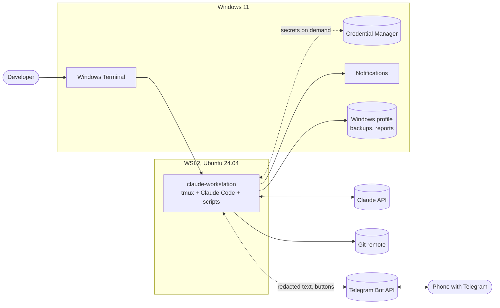
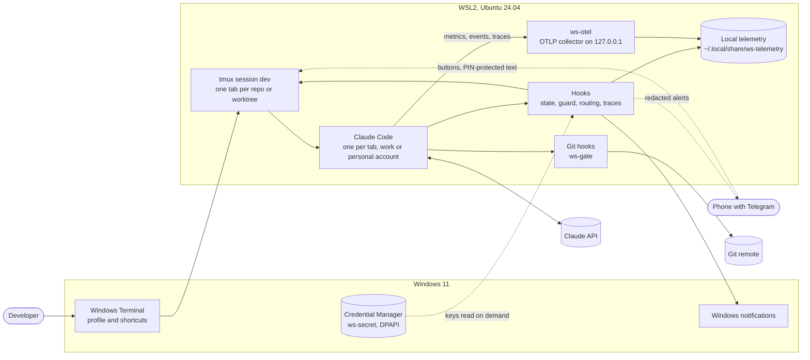
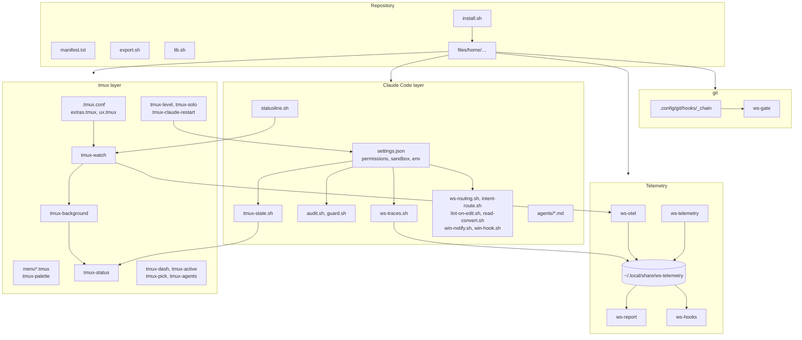
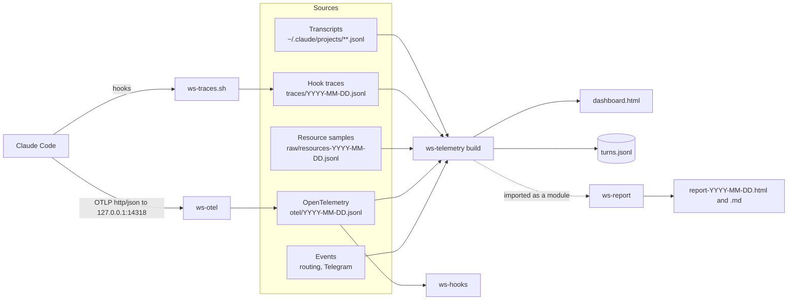
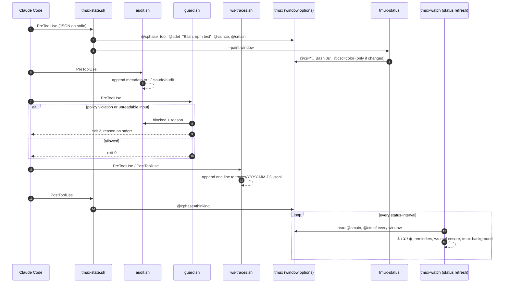
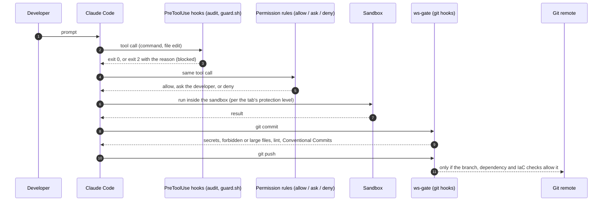
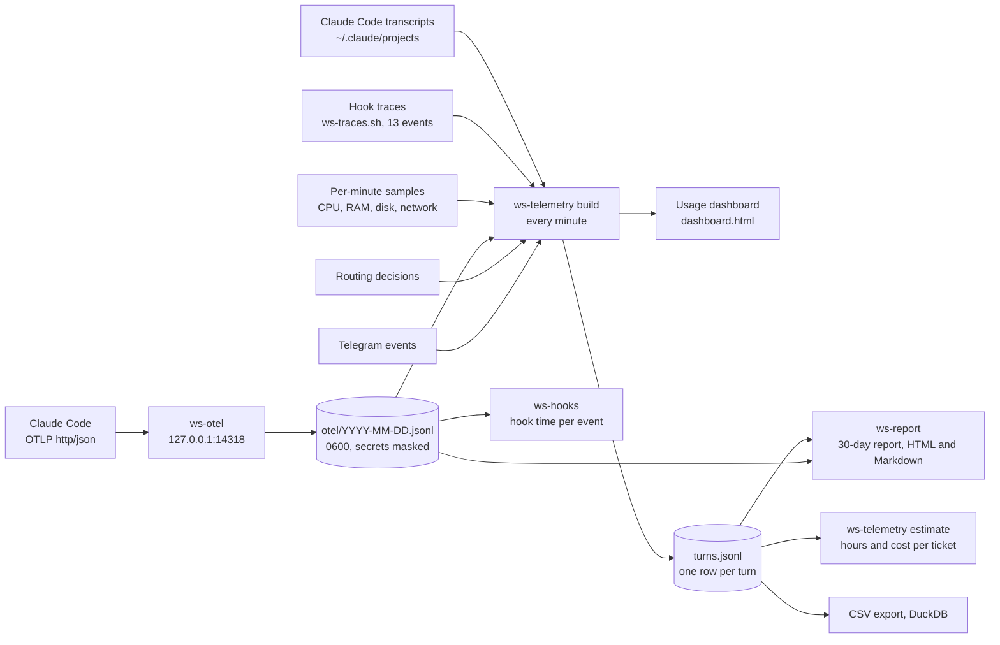
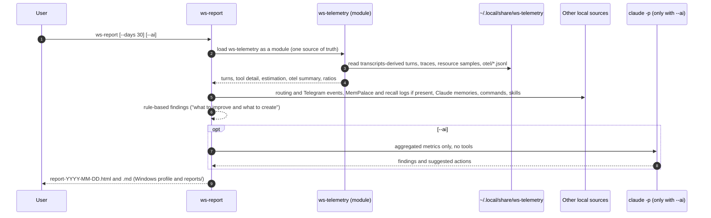
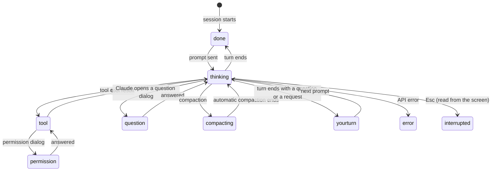
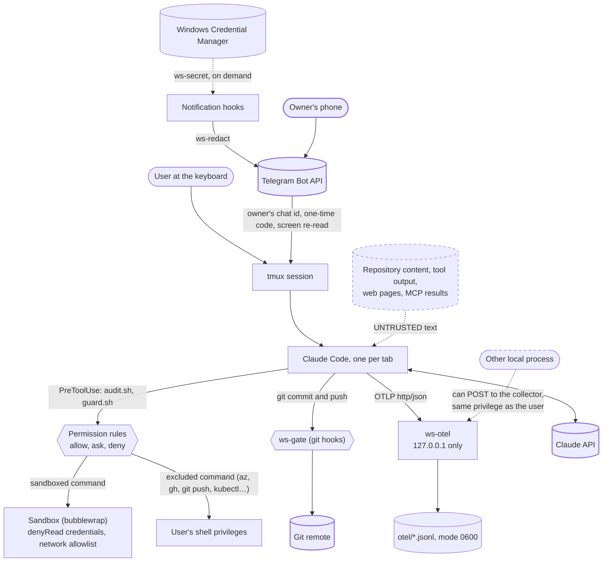

# Diagrams

Every diagram of the documentation in one place. Each one is repeated here unchanged from the document that explains
it; when a diagram changes, change it in both files.

| Diagram | Explained in |
|---|---|
| System context | [architecture.md](architecture.md#context), [README](../README.md#how-it-works) |
| Components | [architecture.md](architecture.md#components), [architecture.md](architecture.md#telemetry) |
| Sequences | [architecture.md](architecture.md#flows) |
| State and lifecycle | [architecture.md](architecture.md#state) |
| Trust boundaries | [THREAT_MODEL.md](THREAT_MODEL.md#trust-boundaries) |

## Contents

- [System context (C4 level 1)](#system-context-c4-level-1)
- [Components (C4 level 2)](#components-c4-level-2)
- [Sequences](#sequences)
- [State and lifecycle](#state-and-lifecycle)
- [Trust boundaries](#trust-boundaries)

## System context (C4 level 1)

### The workstation and its neighbors

The diagram shows the workstation as one system, the people who use it and the systems it talks to (C4 level 1).

What crosses the machine boundary: Claude Code's traffic to the Claude API, git pushes, Telegram messages, the kit's
`claude -p` calls, the optional terminal copilot and the optional encrypted cloud backup. Telemetry does not.

### The workstation at run time

The diagram shows the workstation, the Windows side it relies on and the three external services it talks to.

Solid arrows are local calls and Claude Code's own traffic; dotted arrows are optional or on-demand paths.

## Components (C4 level 2)

### Installed components

The diagram shows the groups of files the installer puts in place and how they call each other (C4 level 2).

### Telemetry sources and readers

The diagram shows which process writes each telemetry source and which commands read the result.

## Sequences

### A Claude hook event

The sequence shows a Bash tool call in a tab, from the hooks' point of view.

### Guardrails on every command and commit

The sequence shows the checks a tool call, a commit and a push go through before anything reaches the remote.

### Local data becomes the dashboard and the reports

The flowchart shows how raw local data becomes the dashboard, the report and the exports.

### A report is built

The sequence shows what `ws-report` reads and when it calls Claude.

## State and lifecycle

The state diagram shows the phases of a tab and what moves it from one to the next.

The state names are the values stored in the tmux window option `@cphase`.

## Trust boundaries

The diagram shows where untrusted text enters, which checks a tool call crosses and what leaves the machine.

Dashed nodes are untrusted inputs; nodes with a thick border are outside the machine.
