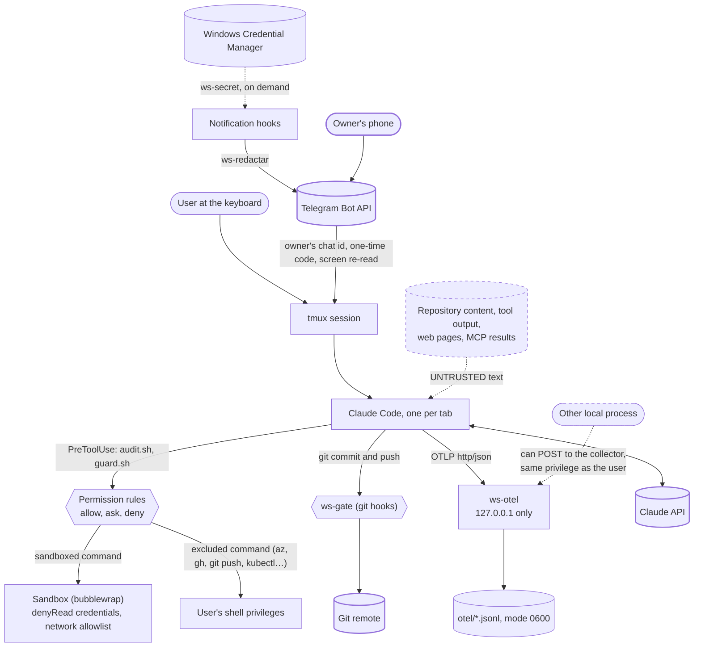

# Threat model

A STRIDE-oriented look at claude-workstation: a developer workstation on WSL2 where several Claude Code agents run
with the user's privileges, read repositories and tool output that the user does not control, and can be answered from
a phone. This document describes the controls **as the code implements them today**, states the residual risk of each,
and lists what is decided but not built yet.

The controls here are defense in depth for one developer's machine. They do not replace cloud RBAC, branch protection
on the remote, or human review.

## Contents

- [Assets](#assets)
- [Trust boundaries](#trust-boundaries)
- [STRIDE](#stride)
- [Supply chain](#supply-chain)
- [Accepted risks](#accepted-risks)
- [Out of scope](#out-of-scope)
- [Review](#review)

## Assets

| Asset | Why it matters |
|---|---|
| Credentials on the machine (`~/.ssh`, `~/.azure`, `~/.aws`, `~/.kube`, `~/.config/gh`, `~/.gnupg`, Docker config, Claude logins) | Whoever reads them acts as the user against cloud, clusters and source control. |
| Secrets in the Windows Credential Manager (`ws/<name>`: Telegram bot token and PIN, the backup key) | Control of the remote channel and of the encrypted backups. |
| Source code and git history of the open repositories | May belong to an employer or a customer; an agent can modify and push it. |
| Remote environments reachable from the machine (cloud subscriptions, Kubernetes contexts, databases) | A single mutating command can be destructive. |
| Conversations (`~/.claude/projects`) and local telemetry (`~/.local/share/ws-telemetria`, in particular `otel/`) | Contain prompts, responses, commands and tool output. |
| The Claude accounts and their usage | Work and personal usage must not be mixed. |
| The workstation's own configuration (`~/.claude/settings.json`, hooks, `core.hooksPath`) | It is what enforces everything else; changing it disables the controls. |

## Trust boundaries

The diagram shows where untrusted text enters, which checks a tool call crosses and what leaves the machine.

Dashed nodes are untrusted inputs; nodes with a thick border are outside the machine.

Text that reaches a model from a repository, a tool, a web page or an MCP server is untrusted: it may contain
instructions. The controls below are deterministic and do not depend on the model declining to follow them.

## STRIDE

The first part describes each control with its residual risk. The second part lists the threats by STRIDE category.

### Controls by component

#### Sandbox

`~/.claude/settings.json` enables Claude Code's sandbox with `failIfUnavailable: true` and
`allowUnsandboxedCommands: false`.

- `filesystem.denyRead` covers the credential stores on both sides of WSL: in the Linux home (`~/.aws`, `~/.azure`,
  `~/.config/gh`, `~/.kube`, `~/.ssh`, `~/.gnupg`, `~/.docker/config.json`, `~/.git-credentials`, `~/.netrc`, package
  manager tokens, the Claude credential files) and in the Windows profile mounted at `/mnt/c/Users/<user>` (the same
  folders plus the GitHub CLI token, the Windows credential stores and the browser profiles). It also covers the local
  OpenTelemetry store, which holds prompt text, the Telegram configuration and the shell history.
- In the full (`completo`) level the profile is generated per project and reads are limited to it: the folders that
  hold other repositories and documents are denied and the tab's project and worktrees are re-allowed.
- Inside the working directory Claude Code keeps `.git/hooks`, `.git/config`, shell startup files and editor folders
  read-only for sandboxed commands; the guard hook blocks the same writes from the file tools.
- MCP tools run outside the sandbox. Tools that send, delete, change or can read secrets are in `permissions.ask`, so
  they always prompt.
- `ws-sandbox-aviso.sh` records and announces sandbox blocks (network, credential reads, writes). It reads the command
  result, because Claude Code documents no sandbox-violation event; treat it as best effort.
- `network.allowedDomains` is a short list of package registries, GitHub and documentation hosts.
- `excludedCommands` lists commands that run **outside** the sandbox because they need network and credentials:
  `aws`, `az`, `azd`, `gh`, remote git operations, `helm`, `kubectl`, `terraform`, database clients, `pwsh.exe`,
  `obsidian`, and read-only Docker subcommands.

Residual: excluded commands run with the user's full privileges and are constrained only by the permission rules and
the guard. Hooks, the Telegram channel and Claude Code's `!` mode run outside the sandbox at every level. The sandbox
is off in `puro` and in solo mode.

#### Permission rules

| List | Content |
|---|---|
| `allow` | Enumerated read-only commands (`az account show`, `az group list`, `gh pr view`, `gh run list`, read-only `obsidian` subcommands) and reads of the document-conversion cache. No rule with a wildcard in the middle. |
| `ask` | Mutating cloud commands (`aws`, `azd`), `terraform apply/destroy/import/state`, `kubectl apply/delete`, `helm install/upgrade/rollback/uninstall`, database clients, Docker commands that run, build, push or remove, `git add -A`, load tests, and mutating Azure MCP tools. |
| `deny` | Reading credential files (`~/.ssh`, `~/.azure`, `~/.gnupg`, `~/.aws`, `~/.kube`, `~/.config/gh`, Docker config, Claude and copilot credentials); commands that print secrets (`ws-secret get`, `az keyvault secret show`, `az account get-access-token`, key and connection-string listings, AWS secret reads); bypassing the git gate (`--no-verify`, `core.hooksPath`, `ws.gate.*`); deleting GitHub repositories or releases; dangerous `obsidian` subcommands. |

Residual: rules are prefix and glob patterns over the command string. An equivalent command written differently can
miss a rule; the guard covers the variants it knows about, not all of them.

#### Protection levels and the floor

Levels are per tab ([ADR 0012](adr/0012-per-tab-protection.md)); the floor is what none of them removes
([ADR 0013](adr/0013-minimum-protection-floor.md), phase 1).

| Control | `completo` | `normal` | `puro` | solo mode |
|---|---|---|---|---|
| Sandbox | On, no excluded commands | On, with excluded commands | Off | Off |
| `allow` / `ask` | Yes | Yes | No | Yes, with `--permission-mode auto` |
| `deny` (floor) | Yes | Yes | Yes | Yes |
| `guard.sh` (floor) | Yes | Yes | Yes | Yes |
| Telegram may run a proposed command | Yes | Yes | No | No |

How it is enforced: `completo` and `puro` start Claude with `--setting-sources project,local` and a generated
`--settings` profile, so user settings are not loaded as a source. This is necessary because Claude Code merges lists
across sources; passing an empty list does not remove entries. The profiles are regenerated from the live
`settings.json` on each change and stored with mode 0600. If the installed Claude does not support
`--setting-sources`, the level is not applied and the user is told.

Residual:

- `normal` is still the user's settings as they are, including the excluded-command list. The stricter base that
  ADR 0013 decides (sandbox without exclusions by default, with levels adding to it) is not implemented.
- In `puro` and solo mode nothing confines a command the user approves, or that the auto-mode classifier lets through,
  except the `deny` list and the guard.
- A repository's own `.claude/settings*.json` is still loaded in every level and can add allow rules or excluded
  commands.
- The lock icon in the bar comes from a tmux option set when the level is applied, not from the effective
  configuration. A Claude started by hand in a pane does not update it.

#### The guard hook

`~/.claude/hooks/guard.sh` is a PreToolUse hook. It exits 2 with a reason, which Claude receives, and records the
block in the audit log.

| Tool | Blocked |
|---|---|
| Bash | Forced push in its variants (`--force`, `-f`, combined flags such as `-fu`, `+refspec`); `--force-with-lease` is allowed |
| Bash | Push to `main` or `master`: named explicitly, as `refs/heads/…`, through `git -C` or `git -c`, or a bare `git push` while on that branch |
| Bash | `--no-verify` on commit, push, merge, rebase, am, cherry-pick |
| Bash | Any git command that mentions `core.hooksPath` or `ws.gate.*` |
| Bash | Commits whose command contains `Co-authored-by` |
| Bash | Download-and-execute: `curl … \| sh`, `wget … \| sh`, with `sudo`, and `sh <(curl …)` |
| Bash | `ws-secret get` |
| Bash | Mutating `az` commands when the subscription named in the command, or the default one, matches the production pattern |
| Bash | Mutating `kubectl` and `helm` commands when the context named in the command, or the current one, matches the production pattern |
| Write, Edit, MultiEdit, NotebookEdit | Content that matches a secret pattern (private key blocks, AWS access keys, storage account keys, Anthropic, GitHub and Slack tokens, SAS signatures) |

Properties:

- **Fails closed.** Without `jq`, or with input that is not a JSON object, it blocks.
- **Ignores quoted text** when deciding, so `echo "git push --force"` or a commit message that mentions `--no-verify`
  is not blocked.
- The production pattern is `prod|prd|produccion`, overridable with `GUARD_PROD_REGEX`.
- Tested by `tests/guard.sh` (44 cases: 25 that must block, 17 that must pass, invalid input, a normal write), which
  runs inside `tests/run.sh` and CI.

Residual: the guard is a set of regular expressions over the command line. It does not parse shell. Indirection that
it does not see (a script file that pushes, an alias, `eval`, a variable holding the flag, a command hidden inside
quotes and executed by `bash -c`) passes. Production is recognized by name only: a production subscription or context
without `prod` or `prd` in its name is not protected. A hook timeout imposed by Claude Code is outside the script's
control.

#### Commit gate

`~/.config/git/hooks/_chain` runs `ws-gate` on `pre-commit`, `commit-msg` and `pre-push`, then the repository's own
hook.

| Stage | Checks |
|---|---|
| `pre-commit` | gitleaks on staged changes, forbidden or large files, lint of what is staged |
| `commit-msg` | Conventional Commits; no `Co-authored-by` |
| `pre-push` | Direct push to `main`/`master` (unless `ws.gate.allowMain`), dependency scan (osv-scanner), IaC (checkov), tflint, clippy on what changed |

Residual:

- The gate is active only when `git config --global core.hooksPath` points to `~/.config/git/hooks`. `install.sh` sets
  it only when no hooks path is configured, and `--no-git-hooks` skips it; `ws-check` reports whether it is set.
- A repository with its own local `core.hooksPath` (husky, for example) replaces the chain.
- Tools that are not installed are skipped with a warning; without gitleaks, secrets are not scanned.
- checkov and tflint only warn unless `ws.gate.strict` is set. `ws.gate.skip` disables individual checks per
  repository. The guard and the `deny` rules stop Claude from changing these settings; the user can.

#### Secrets

- **`ws-secret`** stores and reads secrets in the Windows Credential Manager (generic credentials named `ws/<name>`,
  protected per Windows user) through PowerShell and `advapi32`. The value travels over stdin and stdout; it is never
  placed in a command line, a file or an exported variable. Names are validated against `^[A-Za-z0-9._-]+$`.
- **Claude cannot read them**: `ws-secret get` is in the `deny` list and blocked by the guard.
- **`export.sh`** scans everything it is about to put in the kit and aborts, deleting the partial export, on any match.
- **gitleaks** runs in the commit gate and in CI with `.gitleaks.toml`.
- **`ws-redactar`** is a stream filter that masks GitHub, Slack, `sk-…` and AWS tokens, JWTs, Azure AD client secrets,
  `Bearer` and `Basic` values, SAS signatures, passwords in URLs, `key = value` pairs with well-known names, and
  private key blocks. It is applied to panes pasted into Claude (`Ctrl+b e`), Telegram messages, command-finished
  notifications, log alarms, recorded screen text, the searchable history, handoff summaries and the personal
  configuration repository before each commit.
- **`ws-historial`** lists shell history lines that look like they contain secrets without printing them.

Residual: every one of these detectors is pattern-based. A secret with an unrecognized shape is not masked. The
header of `ws-redactar` says so: it is a safety net, not a replacement for not printing secrets. Windows notifications
are local and are not redacted by `win-notify.sh`. A `.cast` recording made with `tmux-grabar` stores the screen as it
was; only its `.txt` companion is redacted.

#### Telegram remote control

Optional (`ws-telegram configurar`). A local service polls the Bot API, sends notifications and handles replies.

| Threat | Mitigation in the code |
|---|---|
| Someone else talks to the bot | Buttons and messages are accepted only from the chat id fixed at setup; anything else is answered "Not authorized", logged, and the owner is alerted (rate-limited). |
| Replay or late tap | Each notification carries a random one-time code that expires in 10 minutes and is deleted on first use. |
| The dialog changed since the notification | Before sending a key, the pane is read again; if the dialog is different, nothing is sent. |
| Arbitrary text injected into a tab | Buttons carry closed options only (a number or Escape). Free-text replies are off by default; when enabled they require a 4–6 digit PIN at the start of the message, kept in the Credential Manager. The message with the PIN is deleted from the chat. Three wrong PINs in an hour turn free text off. |
| The bot token leaks | The token is read from the Credential Manager and passed to `curl` through a file descriptor, not argv. |
| Screen text with secrets leaves the machine | Outgoing text and command output pass through the redaction filter. A proposed command that changes when redacted is treated as dangerous and gets no button. |
| A command proposed by the model is run from the phone | The "▶ Run" button is offered only for commands that pass two block lists (privilege escalation, deletes, deployments, infrastructure and cluster mutations, any git push, container execution, credential paths, data upload with curl, running local scripts, download-and-execute) and the check is repeated at execution time. It is never offered or executed in a tab without a sandbox (`puro` or solo mode). |

Residual:

- **Running a proposed command asks for the PIN** (on by default): the button runs nothing; the bot asks for the PIN
  in a reply, deletes that reply from the chat, and three wrong PINs in an hour cancel the pending commands.
  `ws-telegram ejecutar sin-pin` turns this off. The filter behind it is still a block list, not an allow list, and the
  command runs as Claude's `!` input, which is outside the sandbox: the read-only allow list that ADR 0013 decides is
  not implemented.
- The Bot API is a third party: notification text, after redaction, is stored by Telegram.
- Events are logged locally without screen text; there is no tamper protection on that log.

#### Telemetry and audit data

- **Hook traces, transcript-derived metrics and the audit log** store metadata: names, counts, sizes, timings,
  summarized actions, and commands with secrets redacted in the audit log. No prompt text.
- **The OpenTelemetry collector** ([ADR 0014](adr/0014-local-opentelemetry-collector.md)) is a deliberate exception: it
  stores everything Claude Code emits, including the text of prompts and responses and tool parameters and content.
  Mitigations: it binds `127.0.0.1` only; the directory is 0700 and files 0600; values that match secret patterns are
  replaced with `[SECRET]` before writing; request bodies are capped at 16 MiB; raw API bodies are not enabled;
  retention is 395 days with compression after 35. `WS_OTEL_CONTENIDO=0` drops content and identity attributes and
  keeps counts, timings and names.
- **The dashboard** embeds data in an HTML file; `</` is escaped so a branch or file name cannot close the script
  block.
- `ws-auditoria` checks that telemetry export points only to the local collector.

Residual:

- The disk holds conversation text in clear, in `otel/` and in Claude Code's own transcripts. Masking is by pattern.
  The data is as protected as the user's home directory: no encryption at rest beyond what the disk provides.
- The collector has no authentication. Any local process can post fabricated signals to port 14318 and skew the
  reports. It cannot read data back through the collector: `GET` returns no stored data.
- If the exporter endpoints in `settings.json` are changed to a remote host, content would leave the machine. The
  content options (`OTEL_LOG_USER_PROMPTS`, `OTEL_LOG_ASSISTANT_RESPONSES`, `OTEL_LOG_TOOL_DETAILS`,
  `OTEL_LOG_TOOL_CONTENT`) must be turned off first.
- `otel/` must stay out of unencrypted backups and cloud sync folders. This is a rule for the user, not something the
  code enforces for arbitrary tools.

#### Backups

- `ws-backup-lite` never includes credentials (`.credentials.json`, `~/.azure`, `~/.kube`, `~/.aws`, the gh
  configuration), and `ws-restore-lite --probar` verifies that a backup contains none.
- `ws-respaldo-nube` sends backups to a cloud folder only encrypted with `age`; the private key lives in the
  Credential Manager and is shown once for the user's password manager.
- Restores do not clobber: differing files are kept, and the restore refuses to run while Claude is open.

Residual: local backups under the Windows profile (`.claude-wsl-backup`, `.tmux-resurrect-backup`, and
`WSL-Backups\lite` unless `age` recipients are configured) are stored in clear. They contain conversations, the audit
log and captured pane contents, and the incremental copies have no expiry. Encryption and expiry for these are pending
(ADR 0013, phase 2).

### Threats by category

#### Spoofing

| Threat | Control | Residual risk |
|---|---|---|
| Someone impersonates the owner on Telegram | Chat-id check, one-time codes, PIN for free text | An unlocked phone is the owner |
| A web page triggers the `ws-claude://` protocol handler | `tmux-foco` accepts only a pane number and only changes the focused tab; it executes nothing else | None stated |
| A local process posts fake telemetry | Not mitigated (same privilege as the user) | It affects reports only |
| Usage is charged to the wrong account | `claude-cuenta` records the account each tab started with, pins accounts per project, and refuses to switch when both logins belong to the same organization | None stated |

#### Tampering

| Threat | Control | Residual risk |
|---|---|---|
| Prompt injection makes an agent change the repository or the remote | Sandbox, `ask` rules, guard, commit gate | An agent can still commit and push to a feature branch; review happens on the remote |
| An agent disables the controls | Changing `core.hooksPath` and `ws.gate.*` is denied and guarded; `--no-verify` is blocked | Nothing in the kit stops an agent from editing `~/.claude/settings.json` or a hook script when the sandbox allows the write or is off; an organization-managed policy for this is pending |
| A folder or tab name carries shell syntax | The tab's path is escaped in the status-bar branch command | Escaping in the menus is pending |

#### Repudiation

| Threat | Control | Residual risk |
|---|---|---|
| An action cannot be attributed afterwards | `audit.sh` logs sessions, prompts (length only), tool calls, denials and guard blocks with timestamp, repository and branch, for 90 days; `claude-report` summarizes it. Telegram actions are logged | Logs are plain files owned by the user, with no integrity protection |

#### Information disclosure

| Threat | Control | Residual risk |
|---|---|---|
| An agent reads credentials | Sandbox `denyRead`, `deny` rules for the same paths, guard on `ws-secret get` | In `puro` and solo mode the `deny` rules are the only barrier, and they match the Read tool and specific command patterns, not every way of reading a file from a shell |
| Secrets end up in a commit | Guard on writes, gitleaks in the gate and CI, `export.sh` scan | Pattern-based detection |
| Secrets end up in telemetry | Metadata-only traces; masking in the collector | Pattern-based |
| Conversation text leaves the machine | Telemetry is loopback-only; kit channels redact | The Claude API itself receives the conversation by design, and Telegram receives redacted excerpts |

#### Denial of service

| Threat | Control | Residual risk |
|---|---|---|
| A slow or failing hook stalls every session | Observing hooks exit 0 with short timeouts; slow SessionStart hooks run through `ws-cache` with a cap per run | Because the guard fails closed, a broken `jq` blocks every tool call until it is fixed. That is the intended trade-off |
| Runaway spend | The watcher shows USD per hour and alerts above `@cburn_crit`; budgets alert at 80 and 100 percent | These inform; they do not stop a session |
| The collector fills the disk | Compression and retention; content can be turned off | Volume grows with content enabled |

#### Elevation of privilege

| Threat | Control | Residual risk |
|---|---|---|
| From sandboxed to unsandboxed | `allowUnsandboxedCommands: false`; `completo` removes the excluded commands | In `normal`, excluded commands are an intended way out, limited by rules and the guard |
| From the phone to a shell | Block lists, sandbox check, one-time codes | See [Telegram remote control](#telegram-remote-control) |
| From an edited file to code execution outside the sandbox | The lint-on-edit hook does not run the repository's own `eslint` or `prettier`; those remain in the pre-commit stage | None stated |

## Supply chain

- `install.sh` backs up every file it replaces and never deletes. It is run by the user, not by Claude.
- MCP servers whose configured executable path does not exist on the machine are skipped.
- `ws-tools` installs from apt, pipx or GitHub releases verified against the release checksum.
- CI uses only GitHub's own actions, downloads gitleaks at a pinned version and verifies its checksum, runs with
  `contents: read`, and does not persist credentials on checkout. Dependabot updates the workflow actions.
- `ws-actualizar` pulls with `--ff-only`, reinstalls, runs `ws-test` and rolls back on failure.

Residual: `ws-actualizar` trusts the kit's remote; whoever can push to it can change hooks and settings on the next
update. tmux plugins are cloned from their upstream repositories without a pinned revision.

## Accepted risks

These risks are known and accepted as the code stands today. Each is described with its control in
[STRIDE](#stride).

| Risk | Why it is accepted |
|---|---|
| The OpenTelemetry collector keeps prompt, response and tool text on disk | The owner's decision ([ADR 0014](adr/0014-local-opentelemetry-collector.md)): the data stays on the machine, with recognizable secrets masked; `WS_OTEL_CONTENIDO=0` turns content off |
| In `puro`, Claude can read credentials or run destructive commands if you approve them | On purpose ([ADR 0012](adr/0012-per-tab-protection.md)): the level exists to compare against stock Claude Code; the floor stays |
| In `normal`, excluded commands leave the sandbox | An intended way out for commands that need network and credentials, limited by the rules and the guard |
| A broken `jq` blocks every tool call | The guard fails closed; that is the intended trade-off |
| A local process can post fake telemetry | Same privilege as the user; it affects reports only |
| Spend alerts and budgets do not stop a session | They inform; the decision stays with the user |
| All secret detectors are pattern-based | They are a safety net, not a replacement for not printing secrets |

### Pending work

Decided in [ADR 0013](adr/0013-minimum-protection-floor.md) and **not implemented** unless the row says otherwise. Do
not rely on any of the unimplemented items:

| Item | Current state |
|---|---|
| Organization-managed policy carrying the floor | The floor lives in user settings and in the generated profiles. |
| Strict user base, with `normal` and solo mode adding exclusions and `allow` rules through `--settings` | `normal` is the user's settings as written, with excluded commands. |
| PIN and a read-only allow list to run a command from Telegram | PIN implemented (on by default); block lists and the sandbox check instead of an allow list. |
| `install.sh` setting git's hooks path | Implemented: set when no hooks path is configured; an existing one is not replaced; `ws-check` reports it. |
| Escaped paths in the menus | Done for the status bar only. |
| Encrypted backups with expiry | Only the cloud copy is always encrypted; local copies are in clear without expiry. |
| Bar indicator derived from the effective configuration | Derived from a tmux option. |
| A test in `ws-test` for every promise (malicious folder and tab names, Telegram allow list, gate without gitleaks) | Guard bypasses and fail-closed are tested in `tests/guard.sh`; profile generation and the Telegram block lists in `ws-test`. |

## Out of scope

- An attacker who already runs code as the user outside Claude Code: they have the same privileges as every control
  here.
- Compromise of Windows, the WSL kernel boundary, or the Windows Credential Manager.
- The security of Claude Code itself, of the Claude API, of MCP servers and of the tmux plugins.
- Content policy for what the model produces. The kit constrains actions, not text.

## Review

| Item | Value |
|---|---|
| Last review | 2026-11-23, when phase 2 of ADR 0013 was partly implemented. The adversarial review that led to ADR 0013 took place on 2026-11-20 |
| Next review | When a control described here changes (`settings.json` permissions or sandbox, `guard.sh`, `ws-gate`, `ws-telegram`, `ws-otel`, the backup scripts), when an ADR that affects security is added, or when an item of [Pending work](#pending-work) is implemented |

Report vulnerabilities privately as described in [SECURITY.md](../SECURITY.md).
