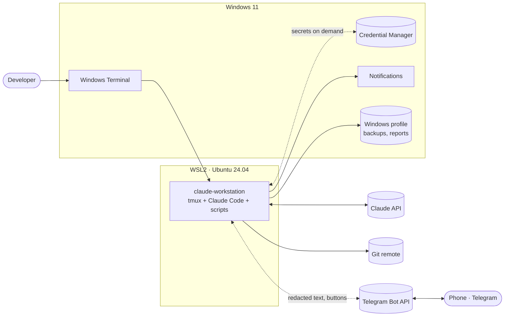
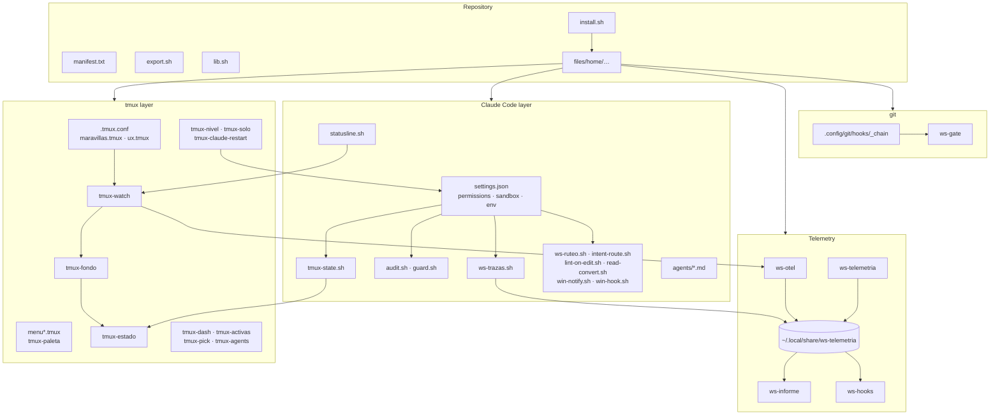
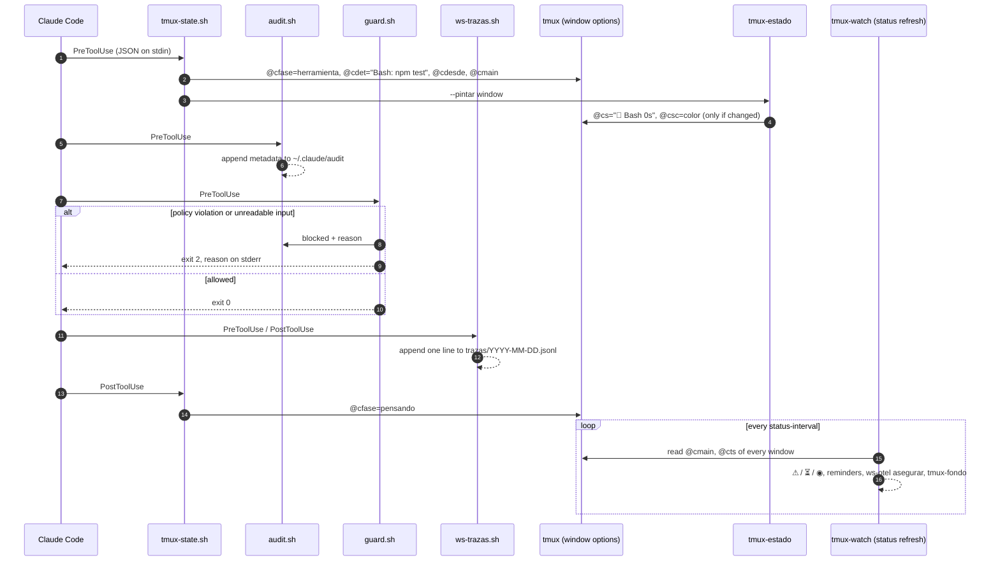
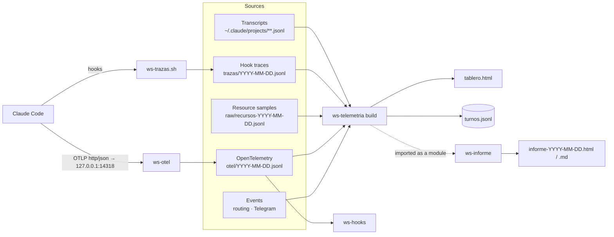
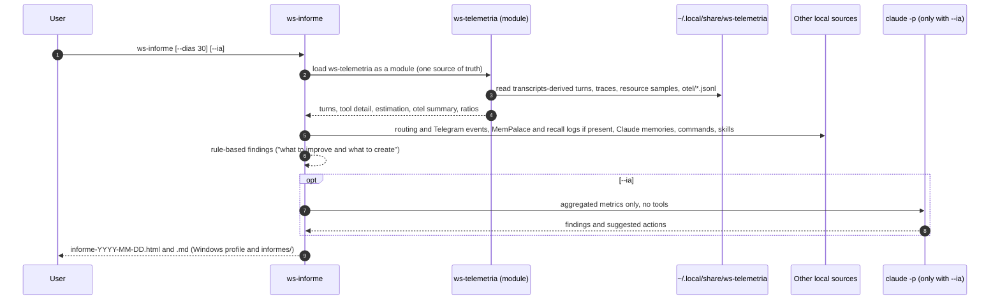

# Architecture

claude-workstation is a set of shell and Python scripts plus configuration files that `install.sh` copies into
`$HOME`. There is no daemon of its own apart from two small background processes (the local OpenTelemetry collector
and, if configured, the Telegram service): everything else runs when tmux refreshes its status bar, when a Claude Code
hook fires, when git runs a hook, or when the user presses a key.

The user interface is in Spanish. Script names, status labels and menu labels are quoted as they appear.

## Contents

- [Context](#context)
- [Components](#components)
- [Installer, manifest and export](#installer-manifest-and-export)
- [tmux layer](#tmux-layer)
- [Claude Code layer](#claude-code-layer)
- [Flow: a Claude hook event](#flow-a-claude-hook-event)
- [Telemetry](#telemetry)
- [Flow: how a report is built](#flow-how-a-report-is-built)
- [Accounts](#accounts)
- [Persistence and backups](#persistence-and-backups)
- [Screensaver](#screensaver)
- [State on disk](#state-on-disk)
- [Design rules](#design-rules)

## Context

What crosses the machine boundary: Claude Code's own traffic to the Claude API, git pushes, Telegram messages (if
configured), the kit's `claude -p` calls (quick question, report findings, handoff summary, learning, swarm planning),
the optional terminal copilot, and the optional encrypted cloud backup. Telemetry does not: its exporter points to
loopback.

## Components

| Component | Files | Responsibility |
|---|---|---|
| Installer | `install.sh`, `export.sh`, `lib.sh`, `manifest.txt`, `secrets-allow.txt` | Capture a machine's configuration as templates and reinstall it with backups. |
| tmux configuration | `.tmux.conf`, `.config/tmux-claude/maravillas.tmux`, `ux.tmux`, themes | Terminal features Claude Code needs, key bindings, window formats, plugins, hooks. |
| Menus | `.config/tmux-claude/menu*.tmux`, `tmux-paleta`, `ws-menus` | The main menu and its submenus; a palette that searches them; a checker and manual generator. |
| Watcher | `tmux-watch`, `tmux-fondo` | Run on every status refresh: waiting and stalled tabs, spend rate, reminders, keeping `ws-otel` alive, background tasks. |
| State | `.claude/hooks/tmux-state.sh`, `tmux-estado` | Hooks record the phase per tab; the painter turns it into a label with elapsed time and corrects it against the screen. |
| Views | `tmux-dash`, `tmux-activas`, `tmux-pick`, `tmux-agents`, `tmux-resumen`, `tmux-hud` | Dashboard, active tabs, tab search, live subagents, tab summary, compute monitor. |
| Protection | `tmux-nivel`, `tmux-solo`, `.config/claude-solo/settings.json`, `tmux-claude-restart` | Restart Claude in a tab with a generated settings profile; restart all free tabs. |
| Claude settings | `.claude/settings.json`, `.claude/statusline.sh`, `.claude/agents/` | Model, permission rules, sandbox, OpenTelemetry export, hook wiring, status line, subagents. |
| Guard and audit | `.claude/hooks/guard.sh`, `audit.sh` | Deterministic PreToolUse blocking; a local audit log of metadata. |
| Routing | `.claude/hooks/ws-ruteo.sh`, `intent-route.sh`, `.local/lib/ws-ruteo.sh`, `cr`, `ws-ruteo-confirmar` | Suggest a model per task and ask before switching. |
| Telemetry | `ws-trazas.sh`, `ws-otel`, `ws-telemetria`, `ws-informe`, `ws-hooks` | Collect, aggregate and report. |
| Commit gate | `.config/git/hooks/_chain`, `ws-gate` | Checks on commit and push, then the repository's own hooks. |
| Accounts | `claude-cuenta`, `.config/tmux-claude/cuentas.sh` | Two Claude accounts, per tab and per project. |
| Secrets | `ws-secret`, `ws-redactar`, `ws-historial` | Windows Credential Manager access, an output redaction filter, a history scanner. |
| Remote control | `ws-telegram`, `ws-aviso`, `win-notify.sh` | Notifications to Windows and Telegram; answering dialogs from the phone. |
| Backups | `tmux-backup`, `ws-backup`, `ws-backup-lite`, `ws-restore-lite`, `ws-respaldo-nube`, `tmux-recuperar` | Session state, conversations and environment data. |
| Screensaver | `tmux-saver`, `tmux-arte`, `tmux-escena` | tmux lock command that draws animated scenes. |
| Health | `ws-check`, `ws-health`, `ws-verify`, `ws-auditoria`, `ws-test` | Status, resilience checks, pre-push verification, audit, behavior tests. |

## Installer, manifest and export

`manifest.txt` lists paths relative to `$HOME`, one per line; a path that ends in `/` means every file directly inside
that directory. Both scripts read it through `lib.sh`.

| Step | `export.sh` (source machine) | `install.sh` (target machine) |
|---|---|---|
| 1 | Deletes `files/` and copies each manifest path from `$HOME` to `files/home/`, keeping file modes and skipping `*.bak.*`. | Copies `files/` to a temporary directory. |
| 2 | Writes the user-level MCP servers from `~/.claude.json` to `files/mcp-servers.json` and copies the Windows `.wslconfig` for reference. | Replaces the placeholders with the target machine's values (`render_templates`). |
| 3 | Replaces personal paths and user names with `@WINHOME@`, `@WIN_USER@`, `@HOME@`, `@LINUX_USER@` (`templatize`). | For each file: `nuevo` (new), `igual` (identical, untouched) or `cambia` (changed: the existing file is copied to `<file>.bak.<timestamp>` first). |
| 4 | Scans the result for secret patterns; on a hit it deletes `files/` and exits. `secrets-allow.txt` lists files that contain the detection patterns themselves (for example `guard.sh`). | Appends the kit's lines to `~/.bashrc` if they are missing, installs TPM and the tmux plugins, and registers MCP servers whose executable exists. |

`install.sh` never deletes files, does not apply `.wslconfig`, and sets git's global hooks path to the kit hooks only when none is configured (`--no-git-hooks` skips it). `--dry-run`
prints the same listing without writing.

`ws-actualizar` wraps the installer for updates: `git pull --ff-only`, `install.sh`, then `ws-test`; if the tests fail
it returns to the previous commit and reinstalls. It does nothing when the kit has local changes or unpushed commits.

## tmux layer

- **Session model.** The main session is `dev`; one window ("tab") per repository or worktree, named after its folder.
  Tabs can be split into groups, one tmux session per group (the labels in `roots.txt`).
- **Status bar.** `status-right` contains the menu button, the output of `tmux-watch`, the active Azure subscription,
  the git branch of the tab and the time. `status-interval` is 15 seconds. Each window format shows a colored dot for
  the Claude state, the number of subagents and the context percentage; the current window also shows the full state
  label.
- **Watcher.** tmux runs `tmux-watch` on every refresh. It reads `@cmain` and `@cts` of every window, builds the
  traffic light (⚠ waiting, ⏳ stalled, ◉ USD per hour, usage limits), sends Windows reminders with a pause between
  them, starts `ws-otel` if it is not running, and launches `tmux-fondo` in the background.
- **Background tasks.** `tmux-fondo` repaints the state of every tab (`tmux-estado --todas`), keeps the label, CI/PR
  and personal segments in the bar, and at most once per minute refreshes CI/PR status per tab (`tmux-rama`) and the
  searchable history if enabled. Once a day it runs `ws-personal sync`.
- **Menus.** Each `menu*.tmux` file is a `display-menu` definition loaded with `source-file`. While a menu is open the
  status refresh is paused (`status-interval 0`) and restored on close, because a refresh redraws over the menu.
- **Floating windows.** Pop-ups run through `tmux-flot-run`, which hosts the command in a separate tmux server
  (`-L flot`) so that scrolling, selection and search work inside the pop-up.

## Claude Code layer

`~/.claude/settings.json` wires thirteen hook events. The scripts follow one rule: hooks that observe always exit 0
and print nothing, so their own failure never blocks Claude; only `guard.sh` (and `read-convert.sh` for unreadable
binaries) can block.

| Hook script | Events | Effect |
|---|---|---|
| `tmux-state.sh` | SessionStart, UserPromptSubmit, PreToolUse, PostToolUse, PostToolUseFailure, Notification, Stop, StopFailure, SubagentStart, SubagentStop, PreCompact, SessionEnd | Writes the tab's phase and details into tmux window options; keeps a subagent registry. |
| `audit.sh` | SessionStart, UserPromptSubmit, PreToolUse, PermissionDenied, SessionEnd (and blocks reported by the guard) | Appends metadata to `~/.claude/audit/YYYY-MM-DD.jsonl`: tool, command with secrets redacted, file path, prompt length. No prompt text. Files older than 90 days are deleted. |
| `guard.sh` | PreToolUse | Blocks policy violations with exit 2. See the [threat model](THREAT_MODEL.md#the-guard-hook). |
| `ws-trazas.sh` | All thirteen | One JSON line per event with counts, timings and names. |
| `ws-ruteo.sh`, `intent-route.sh` | UserPromptSubmit | Model routing with confirmation; a context note suggesting a subagent. |
| `lint-on-edit.sh` | PostToolUse (Edit, Write, MultiEdit) | Runs `ws-gate file` on the edited file and returns findings as context. Never blocks. |
| `read-convert.sh` | PreToolUse (Read) | Converts PDF and Office files to Markdown with `ws-tomd` before Claude reads them. |
| `win-notify.sh` | UserPromptSubmit, Notification, Stop | Windows notification, and Telegram if configured, when a tab you are not looking at needs you or finishes a long turn. |
| `win-hook.sh` | SessionStart, Stop, PreCompact, SessionEnd, UserPromptSubmit | Runs a Windows-side hook executable (the author's memory and retrieval tools), translating paths. |
| `ws-cache` (as a hook wrapper) | SessionStart | Returns the last result of a slow hook at once and refreshes it in the background. |

`statusline.sh` is Claude Code's status line: model, context, cost, usage limits and branch. It also publishes the
context percentage to the tab (`@cctx`) and writes per-session cost samples to `/tmp/claude-burn-<uid>/`, which
`tmux-watch` turns into the spend rate.

Protection levels are applied by restarting Claude with different arguments, not by editing `settings.json`:

| Level | Command `tmux-nivel` / `tmux-solo` types into the pane |
|---|---|
| `normal` | `claude -c` |
| `completo` | `claude -c --setting-sources project,local --settings ~/.config/claude-niveles/completo.json` |
| `puro` | `claude -c --setting-sources project,local --settings ~/.config/claude-niveles/puro.json` |
| solo mode | `claude -c --permission-mode auto --settings ~/.config/claude-solo/settings.json` |

The `completo` and `puro` profiles are generated from the current `~/.claude/settings.json` on every change (mode
0600). `completo` is the whole file with the sandbox forced on, unsandboxed commands disallowed and the excluded
command list removed. `puro` is the whole file with `permissions` reduced to the `deny` list and the sandbox disabled;
hooks, including `guard.sh`, are kept. User settings are not loaded as a source in either case, because Claude Code
merges lists across the sources it loads and a list cannot be removed by overriding it
([ADR-013](adr/0013-minimum-protection-floor.md)).

## Flow: a Claude hook event

A Bash tool call in a tab, from the hook's point of view:

At the end of a turn (`Stop`), `tmux-state.sh` looks at the last assistant message. If it ends in a question or asks
the user to do something (run a command, decide, confirm, provide a value), the phase becomes `tetoca` («👉 te toca»)
instead of `listo`. The decision uses the text only in memory; nothing is stored. `WS_TETOCA=0` disables it.

Window options written by the state hook and read by everything else:

| Option | Meaning |
|---|---|
| `@cfase`, `@cdesde`, `@cdet` | Phase, when it started, detail («Bash: npm test») |
| `@cmain`, `@cmainc` | Coarse state used by the watcher («pensando», «te necesita», «te toca», «listo», «error API») and its color |
| `@cs`, `@csc` | Label shown in the bar and its color, painted by `tmux-estado` |
| `@cts` | Epoch of the last event; the watcher uses it to detect stalls |
| `@cturno`, `@cturno_txt` | Start of the turn and its duration |
| `@csub` | Active subagents, counted from `/tmp/claude-agents-<uid>/<pane>/` |
| `@cctx`, `@cctxc` | Context percentage and its color (from the status line) |
| `@cnivel`, `@cnivel_ico`, `@csolo` | Protection level, its icon, solo-mode flag |
| `@ccuenta` | Account the tab's Claude started with (`trabajo` or `personal`) |

## Telemetry

Four local sources, one aggregator and three readers. All data lives under `~/.local/share/ws-telemetria` (0700).

| Source | Written by | Content | Prompt or tool text? |
|---|---|---|---|
| Transcripts | Claude Code | Exact tokens per response, model, session, folder, branch, subagents | Read only for lengths and counts; never copied |
| Hook traces | `ws-trazas.sh` | Per tool: summarized action, duration, approval wait, error type, bytes, lines changed; prompts as sizes; turns; sessions with commits and diff size | No |
| Resource samples | `ws-telemetria build` (from `/proc`) | CPU, memory and disk operations of Claude processes per project; network | No |
| OpenTelemetry | `ws-otel` | API calls with duration, tokens, cost and origin; API errors by code; permission decisions and who made them; active time; hook duration; compactions; subagents; MCP connections; skills | Yes by default, with secrets masked; `WS_OTEL_CONTENIDO=0` drops it |

**`ws-otel`** ([ADR-014](adr/0014-local-opentelemetry-collector.md)) is a single-file Python HTTP server with no
dependencies. It binds `127.0.0.1` on port 14318 (`WS_OTEL_PUERTO`), accepts OTLP `http/json` bodies up to 16 MiB,
flattens each signal to one JSON line and appends it to a daily file (directory 0700, files 0600). Files are
compressed after 35 days and deleted after `WS_OTEL_RETENCION_DIAS` (395). The `env` block of `settings.json` turns on
Claude Code's metrics, events and traces exporters and points them at the collector. `tmux-watch` starts the collector
when it is not running. Export is configured when Claude starts, so tabs that were already open emit nothing until
they are restarted.

**`ws-telemetria build`** is triggered at most once a minute by `tmux-backup` (the post-save hook of tmux-resurrect).
It samples resources, recomputes turns from the transcripts, aggregates everything, renders `tablero.html` from
`~/.config/ws-telemetria/tablero.plantilla.html` (embedded data escapes `</`), writes `turnos.jsonl`, and copies the
dashboard to the Windows profile. Only the user's own messages open a turn; tool output, system entries and compaction
summaries are counted as automatic turns. Costs are computed from a price table that
`~/.config/ws-telemetria/precios.json` can override.

**Estimation ratios** (`razones` in `ws-telemetria`) are unit rates over the last 30 days: words per turn, tokens per
word, calls per turn, output speed, cost per turn, per thousand words, per million tokens and per active hour, and
CPU, disk and RAM per token and per turn. Each carries the size of the sample it was computed from. The dashboard and
`ws-informe` both show them.

## Flow: how a report is built

The kit's `claude -p` calls (report, learning, handoff, quick question, swarm) run outside the tab's hooks, so model
routing cannot intercept them.

## Accounts

`claude-cuenta` runs two Claude accounts on one station using Claude Code's `CLAUDE_CONFIG_DIR`:

| Account | Config directory | Notes |
|---|---|---|
| `trabajo` (work) | `~/.claude` | Default; `CLAUDE_CONFIG_DIR` unset |
| `personal` | `~/.claude-personal` | Own login and account state; everything else is a symlink into `~/.claude` |

`claude-cuenta setup` links settings, hooks, agents, commands, skills, conversations (`projects`), tasks, plans and
history from `~/.claude`, and copies only the onboarding state, trusted folders and MCP servers into the personal
`.claude.json`. Credentials and account identity are never copied. Because conversations are shared, switching a tab
(`claude-cuenta pestaña`) exits Claude, sets or unsets `CLAUDE_CONFIG_DIR` in the pane's shell, and resumes the same
conversation with `claude -c`. The switch refuses if both accounts are logged in to the same organization.

Which account a new shell uses is decided by `cuentas.sh`, sourced from `~/.bashrc`:

1. If the working directory is inside a project pinned in `~/.config/claude-cuentas/proyectos.conf` (the repository
   root, any subfolder, or a `<repo>.wt/…` worktree), the pinned account wins.
2. Otherwise, the default account in `~/.config/claude-cuentas/activa`.

The SessionStart hook records which account the tab's Claude actually started with in `@ccuenta`.

## Persistence and backups

| Mechanism | What it saves | Where | When |
|---|---|---|---|
| tmux-resurrect + continuum | Tabs, panes, pane contents; Claude is restored through `claude-resume` | `~/.local/share/tmux/resurrect` | Every minute, and `tmux-save-now` on structural changes (at most once every 10 s) |
| `tmux-recuperar` | Guards against an empty save overwriting a good one; lists saves and restores a chosen one | — | On server start and after each save |
| `tmux-backup` | Copies resurrect saves to the Windows profile | `%UserProfile%\.tmux-resurrect-backup` | After each save |
| `ws-backup` | Conversations and the audit log, incremental, never deleting at the destination | `%UserProfile%\.claude-wsl-backup` | After a save, rate-limited |
| `ws-backup-lite` | Claude data, tmux saves, tmux-claude configuration, an inventory for reinstalling. Never credentials. Optional `age` encryption | `%UserProfile%\WSL-Backups\lite`, rotation of 14 | When the last one is older than 20 h |
| `ws-respaldo-nube` | The last light backup, always encrypted with `age` | OneDrive (the organization's folder when there is one), `Respaldos\estacion-wsl` | Optional; when the last copy is older than 20 h |
| `ws-personal` | Personal configuration listed in `incluir.txt` | A private git repository | Once a day |

`ws-restore-lite --probar` extracts a backup into a temporary folder and verifies it without touching `$HOME`;
`--restaurar` extracts into `$HOME`, keeps differing files as `<file>.~N~`, and refuses to run while Claude is open.

## Screensaver

`tmux-theme` sets `tmux-saver` as tmux's `lock-command` with `lock-after-time` (10 minutes by default). `tmux-saver`
does not start in presentation mode or while any tab has a permission dialog open; «te toca» does not hold it back.
It picks a scene and delegates the drawing:

- **`tmux-arte`** draws all built-in scenes: 25 animated ASCII scenes that adapt to the terminal size and use 24-bit
  color when the terminal announces it (256 colors otherwise). 13 are drawn directly with characters; 12 use a shading
  engine that renders each frame as a color image at a higher resolution than the terminal and maps it to characters.
  The shading engine needs `python3-numpy`; without it those scenes are left out of the random choice.
- **`galeria`** shows the user's own images and animated GIFs from `~/.config/tmux-claude/galeria` (or `WS_GALERIA`)
  converted to characters by `chafa`. It joins the random choice only when `chafa` is installed and the folder has
  images.

Preferences (`protector`, `escena`, `minutos`) are stored in `~/.config/tmux-claude/apariencia`. A saved scene that no
longer exists falls back to random.

## State on disk

| Path | Content | Mode |
|---|---|---|
| `~/.local/share/ws-telemetria/` | `tablero.html`, `turnos.jsonl`, `trazas/`, `otel/`, `raw/`, `informes/`, `telegram/`, `niveles/`, `avisos/` | 0700 |
| `~/.claude/audit/` | Audit log, one JSONL file per day, 90 days | 0700 |
| `~/.config/claude-niveles/` | Generated `completo.json` and `puro.json` | 0700 / 0600 |
| `~/.config/claude-cuentas/` | `activa`, `proyectos.conf` | `proyectos.conf` 0600 |
| `~/.config/ws-telegram/`, `~/.local/state/ws-telegram/` | Chat id and switches; pending one-time codes | created with umask 077 |
| `/tmp/claude-agents-<uid>/`, `/tmp/claude-watch-<uid>/`, `/tmp/claude-burn-<uid>/` | Subagent registry, reminder timestamps, cost samples | — |
| `${XDG_RUNTIME_DIR:-/tmp}/ws-otel-<uid>/`, `ws-cache-<uid>/` | Collector pid; cached command output | 0700 |
| Windows Credential Manager (`ws/<name>`) | Telegram bot token and PIN, the backup key | DPAPI, per Windows user |

## Design rules

- **Local first.** Telemetry, audit and reports stay on the machine. Anything the kit itself sends out passes through
  `ws-redactar` first.
- **Observing hooks never block.** They exit 0 and write nothing to stdout. Blocking is reserved for the guard, which
  fails closed.
- **Write tmux options only when they change.** Every write redraws the bar; a tool fires several events per second.
- **No clobbering.** The installer backs up every file it changes; restores keep differing files.
- **Human in the loop** for anything destructive or outbound: model switches, swarm integration, learning, Telegram
  replies and pushes all wait for a decision.
- **Generated, not hand-kept.** Protection profiles are generated from the live settings; the manual is generated from
  the installed menus (`ws-menus --manual`).
