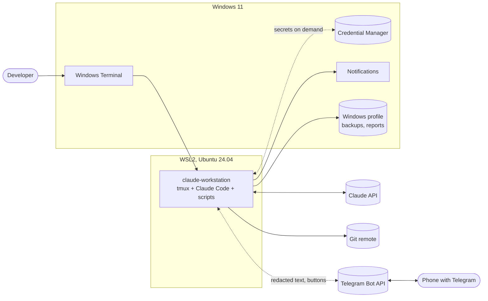
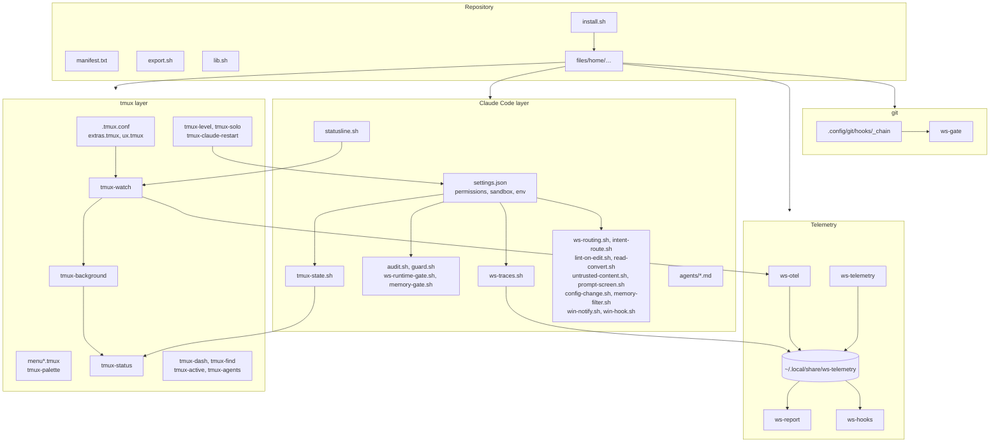
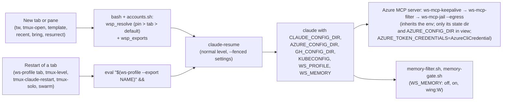
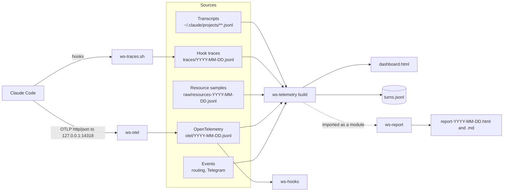
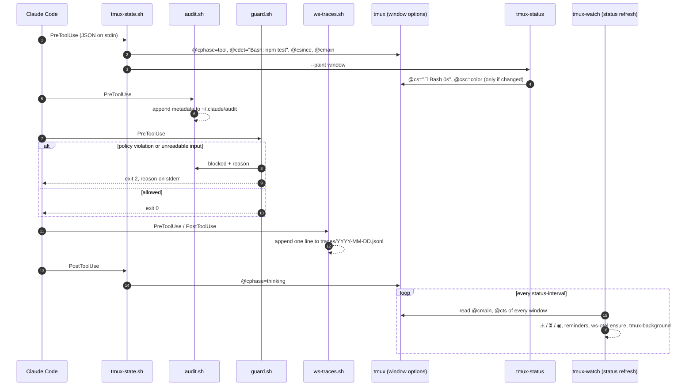
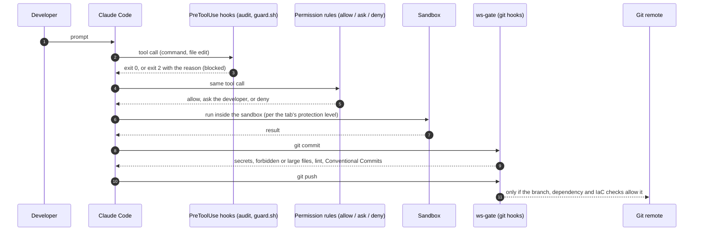
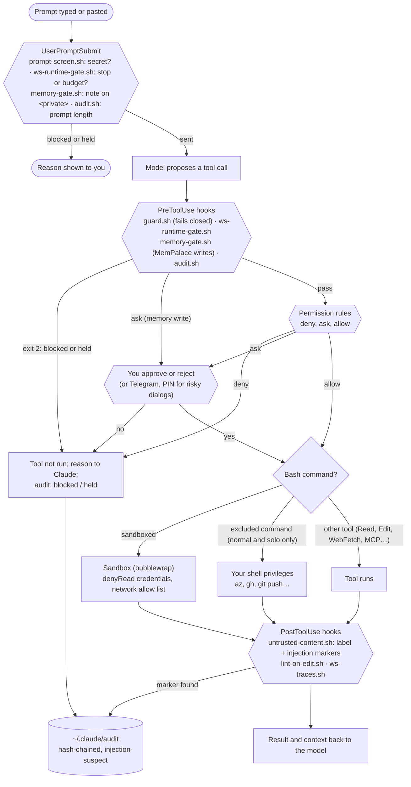
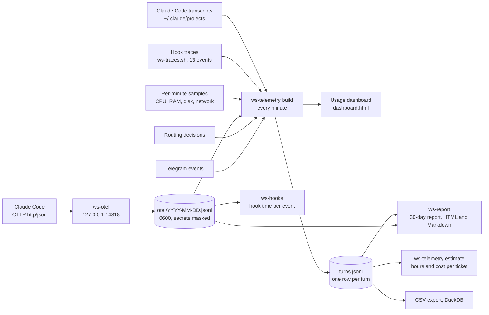
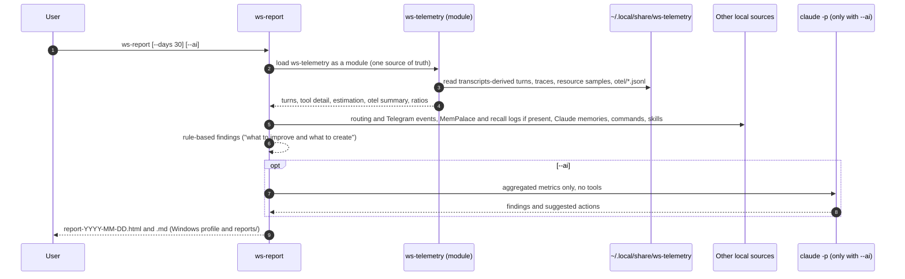
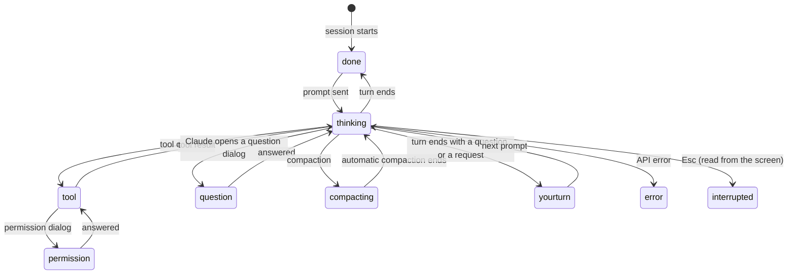

# Architecture

claude-workstation is a set of shell and Python scripts plus configuration files that `install.sh` copies into
`$HOME`. There is no daemon of its own apart from two small background processes (the local OpenTelemetry collector
and, if configured, the Telegram service): everything else runs when tmux refreshes its status bar, when a Claude Code
hook fires, when git runs a hook, or when you press a key.

The interface and every identifier are in English. Script names, flags, tmux options and stored values are quoted as
they are in the code (`tmux-status`, `@cphase=thinking`, `full`). The names used before 3.0 and how an installation
moves to the new ones are in [USAGE.md](USAGE.md#18-upgrading-from-2x-names).

## Contents

- [Context](#context)
- [Components](#components)
- [Installer, manifest and export](#installer-manifest-and-export)
- [tmux layer](#tmux-layer)
- [Claude Code layer](#claude-code-layer)
- [Telemetry](#telemetry)
- [Accounts and profiles](#accounts-and-profiles)
- [Persistence and backups](#persistence-and-backups)
- [Screensaver](#screensaver)
- [Language packs](#language-packs)
- [Flows](#flows)
- [State](#state)
- [Design patterns](#design-patterns)
- [Invariants](#invariants)
- [Decisions](#decisions)

## Context

The diagram shows the workstation as one system, the people who use it and the systems it talks to (C4 level 1).

What crosses the machine boundary: Claude Code's own traffic to the Claude API, git pushes, Telegram messages (if
configured), the kit's `claude -p` calls (quick question, report findings, handoff summary, learning, swarm planning),
the optional terminal copilot, and the optional encrypted cloud backup. Telemetry does not: its exporter points to
loopback.

## Components

The diagram shows the groups of files the installer puts in place and how they call each other (C4 level 2).

| Component | Files | Responsibility |
|---|---|---|
| Installer | `install.sh`, `export.sh`, `lib.sh`, `migrate.sh`, `renames.tsv`, `manifest.txt`, `secrets-allow.txt` | Capture a machine's configuration as templates and reinstall it with backups; move an installation from the names used before 3.0 to the English ones. |
| tmux configuration | `.tmux.conf`, `.config/tmux-claude/extras.tmux`, `ux.tmux`, themes | Terminal features Claude Code needs, key bindings, window formats, plugins, hooks. |
| Menus | `.config/tmux-claude/menu*.tmux`, `tmux-palette`, `ws-menus` | The main menu and its submenus; a palette that searches them; a checker and manual generator. |
| Watcher | `tmux-watch`, `tmux-background` | Run on every status refresh: waiting and stalled tabs, spend rate, reminders, keeping `ws-otel` alive, background tasks. |
| State | `.claude/hooks/tmux-state.sh`, `tmux-status` | Hooks record the phase per tab; the painter turns it into a label with elapsed time and corrects it against the screen. |
| Views | `tmux-dash`, `tmux-find`, `tmux-active`, `tmux-favorites`, `tmux-recent`, `tmux-agents`, `tmux-summary`, `tmux-hud` | Dashboard, the finder and the lists behind its views (active tabs, favorites, recent conversations), live subagents, tab summary, compute monitor. |
| Tab resources | `tmux-res`, `tmux-fit` | One sampler per tmux server walks `/proc` every 2 s and writes each tab's CPU, RAM (PSS), I/O, TCP traffic and GPU as window options (`@res_p`, `@res_c`, `@res_t`); the bar only reads them. `tmux-fit` gives a `#()` segment a fixed width. [ADR 0029](adr/0029-per-tab-resources-and-fixed-width-status-bar.md) |
| Protection | `tmux-level`, `tmux-solo`, `claude-resume`, `.config/claude-levels/normal-adds.json`, `.config/claude-solo/settings.json`, `tmux-claude-restart` | Restart Claude in a tab with a profile generated on top of the strict base; agent identities; solo expiry; restart all idle tabs. |
| Claude settings | `.claude/settings.json`, `.claude/statusline.sh`, `.claude/agents/` | Model, permission rules, sandbox, OpenTelemetry export, hook wiring, status line, subagents. |
| Guard and audit | `.claude/hooks/guard.sh`, `audit.sh`, `config-change.sh`, `.local/lib/ws-credential-paths.txt` | Deterministic PreToolUse blocking (fails closed), including the agent's own configuration and credential paths; a hash-chained local audit log of metadata; configuration changes recorded. |
| Content and memory gates | `.claude/hooks/untrusted-content.sh`, `prompt-screen.sh`, `memory-gate.sh`, `memory-filter.sh`, `ws-memory` | Label untrusted tool output and screen it for injection markers; stop prompts that carry secrets; ask for every memory write with stamped provenance; keep `<private>` text out of memory. |
| Containment | `.claude/hooks/ws-runtime-gate.sh`, `ws-stop-all`, `ws-anomaly` | The emergency stop and the hard spend limit, held in every Claude by one hook; anomaly detection over the audit log and sandbox hits. |
| Supply chain | `files/mcp-servers.lock.json`, `.local/lib/ws-npm/`, `ws-pinned`, `ws-kit-update`, `.config/ws-kit/allowed_signers`, `agent-browser` | Pinned MCP servers and agent tools; signed kit releases; the browser wrapper's safe defaults. |
| MCP confinement | `ws-mcp-jail`, the `jail` keys of `files/mcp-servers.json`, `lib.sh` (`mcp_want`, `mcp_allowlist`) | Local Linux MCP servers run in bubblewrap with only their state dir writable; the managed `allowedMcpServers` drop-in ([ADR 0024](adr/0024-mcp-server-confinement-and-allow-list.md)). |
| MCP keepalive | `ws-mcp-keepalive`, the `keepalive` keys of `files/mcp-servers.json`, `lib.sh` (`mcp_want`, `mcp_unwrap`) | Every local MCP server (outside its jail, if any) behind a stdio proxy that restarts it when it exits mid-session, replays the handshake and answers lost requests with an error; logs and audits each restart ([ADR 0025](adr/0025-mcp-server-keepalive.md)). |
| MCP policy filter and pins | `ws-mcp-filter`, `ws-mcp-tools`, `files/home/.local/lib/ws_mcp_policy.py`, `~/.config/ws-mcp/filter.json` (+ `filter.local.json`), `mcp-pin-gate.sh` | Between the keepalive and the jail: tools per level and profile, caps, redaction, provenance of memory writes; tool definitions pinned in `~/.local/share/ws-kit/mcp-tools.lock.json`, a change withheld until the owner approves it ([ADR 0027](adr/0027-mcp-stdio-policy-filter-and-tool-pinning.md)). |
| MCP egress | `ws-egress-proxy`, `ws-mcp-jail --egress`, `~/.config/ws-mcp/egress.json` (+ `egress.local.json`) | A jailed server without a network of its own reaches only its listed hosts through a proxy outside the jail; audit or enforce ([ADR 0028](adr/0028-network-per-level-mcp-egress-and-settings-menu.md)). |
| Settings | `ws-settings`, `menu-settings.tmux` | Every owner setting with its current value, from Menu → Settings; refused inside Claude and blocked by the guard ([ADR 0028](adr/0028-network-per-level-mcp-egress-and-settings-menu.md)). |
| Managed policy | `files/etc/claude-code/managed-settings.json` (installed by `install.sh --managed`) | The deny floor and the guard as a root-owned drop-in. |
| Compliance | `.local/lib/ws_compliance.py` (`ws-audit --compliance`), `docs/compliance/`, `tests/compliance.sh`, `tests/ai-bom.sh` | Run the catalogue's machine-checkable checks; keep the catalogue, the assessment and the AI-BOM in step with the code. |
| Routing | `.claude/hooks/ws-routing.sh`, `intent-route.sh`, `.local/lib/ws-routing.sh`, `cr`, `ws-routing-confirm` | Suggest a model per task and ask before switching. |
| Telemetry | `ws-traces.sh`, `ws-otel`, `ws-telemetry`, `ws-report`, `ws-hooks` | Collect, aggregate and report. |
| Commit gate | `.config/git/hooks/_chain`, `ws-gate` | Checks on commit and push, then the repository's own hooks. |
| Accounts and profiles | `ws-profile`, `.local/lib/ws-profile.sh`, `claude-account`, `.config/tmux-claude/accounts.sh` | Per-tab profiles: Claude organisation, Azure tenant, gh, kubectl, conversations and memory per tab and per project; `work` and `personal` built in. |
| Secrets | `ws-secret`, `ws-redact`, `ws-history` | Windows Credential Manager access, an output redaction filter, a history scanner. |
| Remote control | `ws-telegram`, `ws-notify`, `win-notify.sh` | Notifications to Windows and Telegram; answering dialogs from the phone. |
| Backups | `tmux-backup`, `ws-backup`, `ws-backup-lite`, `ws-restore-lite`, `ws-backup-cloud`, `tmux-recover` | Session state, conversations and environment data. |
| Screensaver | `tmux-saver`, `tmux-art`, `tmux-scene` | tmux lock command that draws animated scenes. |
| Health | `ws-check`, `ws-health`, `ws-verify`, `ws-audit`, `ws-test` | Status, resilience checks, pre-push verification, audit, behavior tests. |
| Language | `ws-lang`, `.local/lib/ws-lang.sh`, `.local/lib/ws-lang/en.conf`, `es.conf`, `.config/ws-routing/rules.es.conf` | Select which languages the hooks, routing, Telegram and reports recognize in prompts and answers, and the language Claude writes reports in. |

## Installer, manifest and export

`manifest.txt` lists paths relative to `$HOME`, one per line; a path that ends in `/` means every file directly inside
that directory. Both scripts read it through `lib.sh`.

| Step | `export.sh` (source machine) | `install.sh` (target machine) |
|---|---|---|
| 1 | Deletes `files/` and copies each manifest path from `$HOME` to `files/home/`, keeping file modes and skipping `*.bak.*`. | Copies `files/` to a temporary directory. |
| 2 | Writes the user-level MCP servers from `~/.claude.json` to `files/mcp-servers.json` and copies the Windows `.wslconfig` for reference. | Replaces the placeholders with the target machine's values (`render_templates`). |
| 3 | Replaces personal paths and user names with `@WINHOME@`, `@WIN_USER@`, `@HOME@`, `@LINUX_USER@` (`templatize`). | For each file prints `new`, `same` (identical, untouched) or `changed` (the existing file is copied to `~/.local/share/ws-kit/backup.<timestamp>/<path>` first; the newest 10 folders are kept). |
| 4 | Scans the result for secret patterns; on a hit it deletes `files/` and exits. `secrets-allow.txt` lists files that contain the detection patterns themselves (for example `guard.sh`). | Appends the kit's lines to `~/.bashrc` if they are missing, installs TPM and the tmux plugins, and registers the MCP servers that `files/mcp-servers.lock.json` vouches for: npm servers installed by `ws-pinned` from their committed lock, local executables whose sha256 matches the one pinned on first use, remote servers whose URL matches. Opt-in servers need `--mcp-opt-in`. |

`install.sh` deletes none of your files, does not apply `.wslconfig`, and sets git's global hooks path to the kit hooks
only when none is configured (`--no-git-hooks` skips it). `--dry-run` prints the same listing without writing.
`export.sh` merges the user MCP servers into `files/mcp-servers.json` instead of replacing it, so opt-in servers
that are not registered on the exporting machine stay, and it keeps `files/mcp-servers.lock.json` and `files/etc/`.
`install.sh --managed` is a separate run: with `sudo`, after you confirm, it installs
`files/etc/claude-code/managed-settings.json` as the drop-in `/etc/claude-code/managed-settings.d/50-ws-kit.json`,
a root copy of `guard.sh` in `/etc/claude-code/hooks/` and the credential list in `/etc/claude-code/`.

Before it copies anything, `install.sh` calls `migrate_names` (`migrate.sh`), which moves an installation made before
3.0 to the English names. `renames.tsv` lists each old path, its new path and one of three kinds:

| Kind | Old path is | Action |
|---|---|---|
| `data` | The user's settings or data | Moved to the new name. If the new name already exists, nothing is touched and a warning is printed |
| `shim` | A kit command or hook that something may still call | Set aside and replaced by a wrapper that prints the new name and runs `exec "$HOME/<new>" "$@"` |
| `drop` | A kit file with no caller of its own (menus, themes, agents) | Set aside |

"Set aside" means moved to `~/.local/share/ws-kit/pre-english.<date>/` with its relative path. The migration also
rewrites the `cuentas.sh` line of `~/.bashrc` to `accounts.sh` (with a backup), sets aside the generated profiles of
`~/.config/claude-niveles`, stops the Telegram service and the OpenTelemetry collector of the old version, patches
the Windows `ws-claude://` handler in place (with a backup), and writes `es` to
`~/.config/tmux-claude/lang` when it migrated anything and no language was chosen. It is idempotent: on a migrated or
new machine it does nothing. `install.sh --remove-shims` deletes the wrappers, recognized by a mark line, and exits.

What the installer cannot reach is read under both names by the code that uses it: the `age-respaldo` credential, the
OneDrive folder `Respaldos\estacion-wsl`, the personal repository `~/code/estacion-personal`, backup archives with an
`inventario/` folder, the telemetry history (Spanish field names and values are translated when a record is loaded, by
one mapping table per script; the files are never rewritten) and the Spanish keys of files the user edits. tmux live
state has no compatibility code: the server is restarted after the upgrade.

`ws-kit-update` wraps the installer for updates. It fetches the release tags into `refs/ws-kit/tags`, takes the
newest `vX.Y.Z` ahead of the checkout, verifies it with `git verify-tag` against the **installed**
`~/.config/ws-kit/allowed_signers` (so a release cannot vouch for itself), then `git merge --ff-only <tag>`,
`install.sh` and `ws-test`; if the tests fail it returns to the previous commit and reinstalls. It never follows the
branch tip, and does nothing when the kit has local changes or commits the release does not contain
([ADR 0018](adr/0018-supply-chain-pinning-and-signed-releases.md)).

## tmux layer

- **Session model.** The main session is `dev`; one window ("tab") per repository or worktree, named after its folder.
  Tabs can be split into groups, one tmux session per group (the labels in `roots.txt`).
- **Status bar.** `status-right` contains the menu button, the output of `tmux-watch`, the active Azure subscription,
  the git branch of the tab and the time. `status-interval` is 15 seconds. Each window format shows a colored dot for
  the Claude state, the number of subagents and the context percentage; the current window also shows the full state
  label.
- **Watcher.** tmux runs `tmux-watch` on every refresh. It reads `@cmain` and `@cts` of every window, builds the
  traffic light (⚠ waiting, ⏳ stalled, ◉ USD per hour, usage limits), sends Windows reminders with a pause between
  them, starts `ws-otel` if it is not running, and launches `tmux-background` in the background.
- **Background tasks.** `tmux-background` repaints the state of every tab (`tmux-status --all`), keeps the label, CI/PR
  and personal segments in the bar, and at most once per minute refreshes CI/PR status per tab (`tmux-branch`) and the
  searchable history if enabled. Once a day it runs `ws-personal sync`.
- **Menus.** Each `menu*.tmux` file is a `display-menu` definition loaded with `source-file`. While a menu is open the
  status refresh is paused (`status-interval 0`) and restored on close, because a refresh redraws over the menu.
- **Floating windows.** Popups run through `tmux-popup-run`, which hosts the command in a separate tmux server
  (`-L popup`) so that scrolling, selection and search work inside the popup.

## Claude Code layer

`~/.claude/settings.json` wires fourteen hook events. The scripts follow one rule: hooks that observe always exit 0
and print nothing on failure, so their own failure never blocks Claude. Only the gates block, each with its own
failure mode: `guard.sh` fails closed (and `onFailure: block` makes a missing or crashing guard block too);
`prompt-screen.sh` and the budget part of `ws-runtime-gate.sh` fail open; the stop marker blocks with or without
`jq`; `memory-gate.sh` fails closed for memory writes it cannot read; `read-convert.sh` blocks unreadable binaries.

| Hook script | Events | Effect |
|---|---|---|
| `tmux-state.sh` | SessionStart, UserPromptSubmit, PreToolUse, PostToolUse, PostToolUseFailure, Notification, Stop, StopFailure, SubagentStart, SubagentStop, PreCompact, SessionEnd | Writes the tab's phase and details into tmux window options; keeps a subagent registry. |
| `audit.sh` | SessionStart, UserPromptSubmit, PreToolUse, PermissionDenied, SessionEnd (and events reported by the other hooks: `blocked`, `held`, `injection-suspect`, `memory-write`, `config-change`, `stop-all`…) | Appends metadata to `~/.claude/audit/YYYY-MM-DD.jsonl`: tool, command with secrets redacted, file path, the WebFetch URL without its query, the WebSearch query, a redacted summary of MCP arguments (the input hash for MemPalace), prompt length. No prompt text. Each line carries the sha256 of the previous one; on SessionEnd the day's head goes to `%UserProfile%\ws-telemetry\audit-anchors.txt`. Files older than 395 days are deleted. |
| `guard.sh` | PreToolUse (`onFailure: block`) | Blocks policy violations with exit 2. See the [threat model](THREAT_MODEL.md#the-guard-hook). |
| `ws-runtime-gate.sh` | UserPromptSubmit, PreToolUse | Holds every prompt and tool while `~/.local/state/ws-stop-all` exists, and in projects listed in `~/.local/state/ws-budget-over` (hard budget). The usual case starts no process. |
| `memory-gate.sh` | PreToolUse (`mcp__.*mempalace.*`), UserPromptSubmit | Asks for every MemPalace write (`permissionDecision: ask`), stamps provenance with `updatedInput`, blocks `<private>` text; on a prompt with `<private>`, adds a note for Claude. |
| `memory-filter.sh` | Wraps the MemPalace hooks (SessionStart, Stop, PreCompact, SessionEnd) and recall (UserPromptSubmit) | Replaces `<private>` spans in the prompt and hands MemPalace a redacted copy of a transcript that contains them (`~/.cache/ws-memory/`); runs the wrapped command with the filtered input. |
| `prompt-screen.sh` | UserPromptSubmit | Blocks a prompt that `ws-redact` would change (a secret), unless it starts with `#allow-secret`. |
| `untrusted-content.sh` | PostToolUse (`WebFetch`, `WebSearch`, `mcp__.*`; Bash only through `if` rules for `curl`, `wget`, `gh api`, `gh issue/pr/run/release view`, `gh pr diff`, `gh search`) | Adds context that the result is untrusted data and names any injection markers found; logs hits. Never blocks. |
| `config-change.sh` | ConfigChange | Records every settings, policy or skill file that changes during a session. Never blocks. |
| `ws-traces.sh` | Thirteen (all but ConfigChange) | One JSON line per event with counts, timings and names. |
| `ws-routing.sh`, `intent-route.sh` | UserPromptSubmit | Model routing with confirmation; a context note suggesting a subagent. |
| `lint-on-edit.sh` | PostToolUse (Edit, Write, MultiEdit) | Runs `ws-gate file` on the edited file and returns findings as context. Never blocks. |
| `read-convert.sh` | PreToolUse (Read) | Converts PDF and Office files to Markdown with `ws-tomd` before Claude reads them. |
| `win-notify.sh` | UserPromptSubmit, Notification, Stop | Windows notification, and Telegram if configured, when a tab you are not looking at needs you or finishes a long turn. |
| `win-hook.sh` | SessionStart, Stop, PreCompact, SessionEnd, UserPromptSubmit (behind `memory-filter.sh`) | Runs a Windows-side hook executable (the author's memory and retrieval tools), translating paths. |
| `ws-cache` (as a hook wrapper) | SessionStart | Returns the last result of a slow hook at once and refreshes it in the background. |

Session start does not wait for slow hooks: the SessionStart hooks that take seconds run through `ws-cache`, which
returns the last result at once and refreshes it in the background (a result older than `--max` seconds is not
trusted and the hook is run and awaited).

### Hooks pipeline

The order below is the order in `settings.json`. Claude Code runs the hooks that match one event in parallel and
combines their answers: one exit 2 (or `decision: block`) blocks, an `ask` from a hook forces the permission prompt.
The permission rules and the sandbox apply after the PreToolUse hooks.

| Event | Hooks (matcher) |
|---|---|
| UserPromptSubmit | `prompt-screen.sh`, `tmux-state.sh prompt`, `audit.sh prompt`, `intent-route.sh`, recall through `memory-filter.sh` and `win-hook.sh`, `win-notify.sh prompt`, `ws-routing.sh`, `ws-traces.sh`, `ws-runtime-gate.sh`, `memory-gate.sh` |
| PreToolUse | `tmux-state.sh tool`; `audit.sh tool` and `guard.sh` (`onFailure: block`); `read-convert.sh` and `read-screen.sh` (Read); `ws-traces.sh`; `ws-runtime-gate.sh`; `memory-gate.sh` (`mcp__.*mempalace.*`); `mcp-pin-gate.sh` (`mcp__.*`) |
| PostToolUse | `ws-sandbox-notice.sh` (Bash), `tmux-state.sh posttool`, `lint-on-edit.sh` (Edit, Write, MultiEdit), `ws-traces.sh`, `untrusted-content.sh` (`^(WebFetch\|WebSearch\|mcp__.*)$`, and Bash through nine `if` rules) |
| PostToolUseFailure | `ws-sandbox-notice.sh` (Bash), `tmux-state.sh posttool`, `ws-traces.sh` |
| PermissionDenied | `audit.sh denied`, `ws-traces.sh` |
| SessionStart | `tmux-state.sh start`, `mcp-pin-gate.sh start` (remote tool definitions, in the background), `audit.sh start`, the MemPalace health check (`ws-cache`), MemPalace through `memory-filter.sh`, recall start (`ws-cache`), `ws-traces.sh` |
| Stop | `tmux-state.sh done`, MemPalace through `memory-filter.sh`, `win-notify.sh done`, `ws-traces.sh` |
| PreCompact | MemPalace through `memory-filter.sh`, `ws-traces.sh`, `tmux-state.sh compact` |
| SessionEnd | `tmux-state.sh end`, `audit.sh end` (writes the anchor), MemPalace through `memory-filter.sh`, `ws-traces.sh` |
| ConfigChange | `config-change.sh` |
| Notification, StopFailure, SubagentStart, SubagentStop | `tmux-state.sh`, `win-notify.sh` (Notification), `ws-traces.sh` |

`statusline.sh` is Claude Code's status line: model, context, cost, usage limits and branch. It also publishes the
context percentage to the tab (`@cctx`) and writes per-session cost samples to `/tmp/claude-burn-<uid>/`, which
`tmux-watch` turns into the spend rate.

### Protection levels per tab

`tmux-level` restarts Claude in the tab with the chosen level and resumes the conversation. The bar shows 🔒 for
`full` and 🔓 for `bare`. The user settings are the strict base: they exclude no command from the sandbox, and each
level adds or removes on top of them ([ADR 0019](adr/0019-strict-base-and-level-profiles.md)).

| Level | Sandbox | Kit `allow` / `ask` rules | Floor: `deny` rules + `guard.sh` | Use it for |
|---|---|---|---|---|
| **Full** (`full`) 🔒 | On, no unsandboxed commands and no excluded commands (`az`, `gh`, `git push`, `kubectl`… stay inside and mostly fail) | On | On | Untrusted repositories, risky changes |
| **Normal** (`normal`) | On, with the excluded commands that `~/.config/claude-levels/normal-adds.json` adds | On | On | Daily work |
| **Pure** (`bare`) 🔓 | Off | Off (Claude asks as it would without the kit) | On | Comparing against stock Claude Code |
| **Solo mode** 🤖 | On (`autoAllowBashIfSandboxed`, no unsandboxed retry), no command excluded: normal's excluded commands stay inside and ask; `--with-network-tools` lets them out again, each one asking, for at most 4 h; expires after 4 h. `--unsandboxed` turns it off as an audited exception | On; Claude runs in `auto` permission mode | On | Leaving Claude to work alone on a task ([ADR 0016](adr/0016-solo-mode-inside-the-sandbox.md)) |

The floor is the part no level turns off ([ADR 0013](adr/0013-minimum-protection-floor.md)): the `deny` rules
(credential files, `ws-secret get`, cloud keys and connection strings, bypassing the git gate) and the `guard.sh`
PreToolUse hook, which fails closed. Hooks that do not restrict anything (state, traces, notifications) also stay on in
every level. Organization-managed settings and each repository's own `.claude/settings*.json` always apply. The
original design is in [ADR 0012](adr/0012-per-tab-protection.md). `install.sh --managed` can install the floor as a
root-owned managed policy as well.

Protection levels are applied by restarting Claude with different arguments, not by editing `settings.json`:

| Level | Command `tmux-level` / `tmux-solo` types into the pane |
|---|---|
| `normal` | `claude-resume --settings ~/.config/claude-levels/normal.json` (on top of every settings source) |
| `full` | `claude-resume --setting-sources project,local --settings ~/.config/claude-levels/full-<hash>.json` (one profile per project folder; `full.json` when no folder is given) |
| `bare` | `claude-resume --setting-sources project,local --settings ~/.config/claude-levels/bare.json` |
| solo mode | `claude-resume --permission-mode auto --settings ~/.config/claude-levels/solo.json`; with `--with-network-tools`, `solo-net.json`; with `--unsandboxed`, `solo-unsandboxed.json` |
| any level with `--agent NAME` | The same command prefixed with `WS_AGENT=NAME AZURE_CONFIG_DIR=… GH_CONFIG_DIR=… KUBECONFIG=…` under `~/.config/ws-agent/NAME/` ([ADR 0020](adr/0020-agent-scoped-identities.md)) |
| any restart of a tab | The same command after `eval "$(ws-profile --export NAME)" &&`, NAME being the tab's profile (`@cprofile`), so the pane's shell and its Claude get the profile's environment ([ADR 0021](adr/0021-per-tab-profiles.md)) |

`claude-resume` runs `claude --continue` with those flags when the folder has a conversation and plain `claude` with
the same flags when it has none (a tab where Claude never received a message). Called without `--settings` or
`--setting-sources` (tab launchers, tmux-resurrect, `claude-account`), it adds the normal profile itself, so every kit
launcher starts at the normal level; a `claude` typed by hand runs at the strict base. Then it swaps the `--settings`
file for the copy with the tab's profile fence (`tmux-level --fenced`, below), and `--new` makes it start a new
conversation.

The launch path of a tab, with profiles:

The profiles are generated on every change (mode 0600). `full` is the whole `~/.claude/settings.json` with the
sandbox forced on, unsandboxed commands disallowed, the excluded command list removed and, with a project folder,
reads limited to that project. `bare` is the whole file with `permissions` reduced to the `deny` list and
`disableBypassPermissionsMode`, and the sandbox disabled; hooks, including `guard.sh`, are kept. User settings are
not loaded as a source in either case, because Claude Code merges lists across the sources it loads and a list cannot
be removed by overriding it ([ADR 0013](adr/0013-minimum-protection-floor.md)). `normal.json` is only
`normal-adds.json`, which Claude Code merges on top of the user settings; `solo.json` is
`~/.config/claude-solo/settings.json` with normal's excluded commands turned into `ask` rules and none excluded,
`solo-net.json` adds the exclusions back and `solo-unsandboxed.json` turns the sandbox off, both keeping those `ask`
rules ([ADR 0022](adr/0022-solo-mode-without-excluded-commands.md)). Swarm agents start at `full` with a profile that also denies
`git push` and `gh pr create`/`merge`.

## Telemetry

Four local sources, one aggregator and three readers. All data lives under `~/.local/share/ws-telemetry` (0700). The
diagram shows which process writes each source and which commands read the result.

| Source | Written by | Content | Prompt or tool text |
|---|---|---|---|
| Transcripts | Claude Code | Exact tokens per response, model, session, folder, branch, subagents | Read only for lengths and counts; never copied |
| Hook traces | `ws-traces.sh` | Per tool: summarized action, duration, approval wait, error type, bytes, lines changed; prompts as sizes; turns; sessions with commits and diff size | No |
| Resource samples | `ws-telemetry build` (from `/proc`) | CPU, memory and disk operations of Claude processes per project; network | No |
| OpenTelemetry | `ws-otel` | API calls with duration, tokens, cost and origin; API errors by code; permission decisions and who made them; active time; hook duration; compactions; subagents; MCP connections; skills | Yes by default, with secrets masked; `WS_OTEL_CONTENT=0` drops it |

**`ws-otel`** ([ADR 0014](adr/0014-local-opentelemetry-collector.md)) is a single-file Python HTTP server with no
dependencies. It binds `127.0.0.1` on port 14318 (`WS_OTEL_PORT`), accepts OTLP `http/json` bodies up to 16 MiB,
flattens each signal to one JSON line and appends it to a daily file (directory 0700, files 0600). Files are
compressed after 35 days and deleted after `WS_OTEL_RETENTION_DAYS` (395). The `env` block of `settings.json` turns on
Claude Code's metrics, events and traces exporters and points them at the collector. `tmux-watch` starts the collector
when it is not running. Export is configured when Claude starts, so tabs that were already open emit nothing until
they are restarted.

**`ws-telemetry build`** is triggered at most once a minute by `tmux-backup` (the post-save hook of tmux-resurrect).
It samples resources, recomputes turns from the transcripts, aggregates everything, renders `dashboard.html` from
`~/.config/ws-telemetry/dashboard.template.html` (embedded data escapes `</`), writes `turns.jsonl`, and copies the
dashboard to the Windows profile. Only your own messages open a turn; tool output, system entries and compaction
summaries are counted as automatic turns. Costs are computed from a price table that
`~/.config/ws-telemetry/prices.json` can override.

**Estimation ratios** (`ratios` in `ws-telemetry`) are unit rates over the last 30 days: words per turn, tokens per
word, calls per turn, output speed, cost per turn, per thousand words, per million tokens and per active hour, and
CPU, disk and RAM per token and per turn. Each carries the size of the sample it was computed from. The dashboard and
`ws-report` both show them.

Two kinds of data, with different content rules:

- **Transcript-derived data and hook traces** store counts, timings and names only: no prompt text, no full commands,
  no file contents.
- **The local OpenTelemetry collector** stores everything Claude Code emits, including prompt, response and tool
  text, with secrets that are recognizable by their shape replaced by `[SECRET]`. Set `WS_OTEL_CONTENT=0` to keep
  counts, timings and names only.

Nothing is sent off the machine: the exporter endpoints in `~/.claude/settings.json` point to `127.0.0.1:14318`.

## Accounts and profiles

`claude-account` runs two Claude accounts on one workstation using Claude Code's `CLAUDE_CONFIG_DIR`; since
[ADR 0021](adr/0021-per-tab-profiles.md) they are the two built-in profiles of `ws-profile`, and `claude-account` is a
wrapper of it with the same commands:

| Account | Config directory | Notes |
|---|---|---|
| `work` | `~/.claude` | Default; `CLAUDE_CONFIG_DIR` unset |
| `personal` | `~/.claude-personal` | Own login and account state; everything else is a symlink into `~/.claude` |

`claude-account setup` links settings, hooks, agents, commands, skills, conversations (`projects`), tasks, plans and
history from `~/.claude`, and copies only the onboarding state, trusted folders and MCP servers into the personal
`.claude.json`. Credentials and account identity are never copied. Because conversations are shared, switching a tab
(`claude-account tab`) exits Claude, sets or unsets `CLAUDE_CONFIG_DIR` in the pane's shell, and resumes the same
conversation with `claude-resume` (a new one when the tab never had any). The switch refuses if both accounts are logged in to the same organization.

A custom profile (`ws-profile new NAME`) adds a client: `~/.config/ws-profiles/NAME/profile.conf` (Claude dir, tenant,
subscription, conversation sharing, memory mode, label), its own Claude dir `~/.claude-profiles/NAME` (the kit setup
linked, its own conversations unless `share_conversations` links another profile's) and its `az`, `gh` and `kubectl`
folders in `~/.config/ws-agent/NAME/`, which is also the agent identity of that name. `~/.local/lib/ws-profile.sh`
is the only code that knows a profile; everything else calls it.

Which profile a new shell uses is decided by `accounts.sh`, sourced from `~/.bashrc` (`wsp_resolve`):

1. If the working directory is inside a project pinned in `~/.config/ws-profiles/projects.conf` (the repository root,
   any subfolder, or a `<repo>.wt/…` worktree; the longest match wins), the pinned profile wins.
2. Otherwise, the tab's profile (`@cprofile`), for a split of a profiled tab; a nested shell keeps its parent's.
3. Otherwise, the default in `~/.config/ws-profiles/default` (`ws-profile use`; `work` when the file is missing).

The shell then exports the profile's variables (`wsp_exports`), so a hand-typed `az`, `gh` or `kubectl` in the tab uses
the same identity as its Claude. The SessionStart hook records what the tab's Claude actually started with in
`@cprofile` (and the old `@caccount`), and the bar shows `@cprofile_label` for a custom profile.

The fence: `ws-profile --fence NAME` lists the conversation data of every other conversation store, every profile's
Claude login and, for a profile with its own store, `~/.cache/ws-memory` and the audit log; `tmux-level --fenced`
writes `<level>@NAME.json` with them added to `sandbox.filesystem.denyRead` and as `Read` deny rules, and
`claude-resume` starts Claude with that copy. The profiles' `az`, `gh` and kube folders are denied as a whole
(`~/.config/ws-agent`); their Claude logins by the glob `~/.claude-profiles/*/.credentials.json` in the settings, the
managed policy and the guard's list, and as literal paths by the fence.

## Persistence and backups

| Mechanism | What it saves | Where | When |
|---|---|---|---|
| tmux-resurrect + continuum | Tabs, panes, pane contents; Claude is restored through `claude-resume` | `~/.local/share/tmux/resurrect` | Every minute, and `tmux-save-now` on structural changes (at most once every 10 s) |
| `tmux-recover` | Guards against an empty save overwriting a good one; lists saves and restores a chosen one | Not applicable | On server start and after each save |
| `tmux-backup` | Copies resurrect saves to the Windows profile | `%UserProfile%\.tmux-resurrect-backup` | After each save |
| `ws-backup` | Conversations and the audit log, incremental, never deleting at the destination | `%UserProfile%\.claude-wsl-backup` | After a save, rate-limited |
| `ws-backup-lite` | Claude data (including the audit log and a copy of its anchors), tmux saves, tmux-claude configuration, an inventory for reinstalling. Never credentials. Encrypted with `age` to the cloud key and any `age-recipients`; in clear only with a warning and an `UNENCRYPTED` log line. After each backup it prunes the `ws-backup` and `tmux-backup` copies older than 30 days (`WS_BACKUP_COPY_DAYS`) | `%UserProfile%\WSL-Backups\lite`, rotation of 14 | When the last one is older than 20 h |
| `ws-backup-cloud` | The last light backup, always encrypted with `age` | OneDrive (the organization's folder when there is one), `Backups\workstation-wsl` | Optional; when the last copy is older than 20 h |
| `ws-personal` | Personal configuration listed in `include.txt` | A private git repository | Once a day |

`ws-restore-lite --test` extracts a backup into a temporary folder and verifies it without touching `$HOME`;
`--restore` extracts into `$HOME`, keeps differing files as `<file>.~N~`, and refuses to run while Claude is open. An
encrypted backup is opened with `--identity <age file>` or, by default, with the cloud key from Credential Manager.

## Screensaver

`tmux-theme` sets `tmux-saver` as tmux's `lock-command` with `lock-after-time` (10 minutes by default). `tmux-saver`
does not start in presentation mode or while any tab has a permission dialog open; a tab in "waiting for you" does not
hold it back. It picks a scene and delegates the drawing:

- **`tmux-art`** draws all built-in scenes: 25 animated ASCII scenes that adapt to the terminal size and use 24-bit
  color when the terminal announces it (256 colors otherwise). 13 are drawn directly with characters; 12 use a shading
  engine that renders each frame as a color image at a higher resolution than the terminal and maps it to characters.
  The shading engine needs `python3-numpy`; without it those scenes are left out of the random choice.
- **`gallery`** shows your own images and animated GIFs from `~/.config/tmux-claude/gallery` (or `WS_GALLERY`)
  converted to characters by `chafa`. It joins the random choice only when `chafa` is installed and the folder has
  images.

Preferences (`theme`, `saver`, `scene`, `minutes`) are stored in `~/.config/tmux-claude/appearance`. A saved scene that
no longer exists falls back to random.

## Language packs

The interface is English only. What depends on the language is what the kit recognizes in text typed by the user or
written by Claude, and the language Claude is asked to write in
([ADR 0015](adr/0015-english-names-and-language-selector.md)). Those words and expressions are data, kept out of the
scripts in one pack per language.

| Piece | Where | Role |
|---|---|---|
| Setting | `~/.config/tmux-claude/lang` (`en` or `es`); `WS_LANG` overrides it | Read on every use, so a change needs no restart. Anything else, or no file, means `en` |
| Command | `ws-lang` | Shows, sets and prints the setting, and mirrors it into the tmux option `@ws_lang`, which the Workstation menu shows and toggles |
| Library | `~/.local/lib/ws-lang.sh` | Sourced by the bash consumers. `ws_lang` prints the code, `ws_lang_name` the name, `ws_lang_pat KEY` the English value of a key, joined with the Spanish one by a vertical bar when the setting is `es`, and `ws_lang_list KEY` the same joined by a space. It uses bash builtins only, because hooks run it on every Claude event |
| Packs | `~/.local/lib/ws-lang/en.conf`, `es.conf` | `key=value` lines; the value is a regular expression or a word list taken verbatim. A key is read by exactly one consumer, in that consumer's dialect (`grep -E` or Python `re`) |
| Routing rules | `~/.config/ws-routing/rules.conf` (`level\|id\|expression`, English) and `rules.es.conf` (`id\|expression`) | With `es`, a rule matches when its English or its Spanish expression matches; the rule order does not change |

| Consumer | Keys | What it decides |
|---|---|---|
| `intent-route.sh` | `intent.design`, `intent.explore` | Which subagent to suggest for a prompt |
| `tmux-state.sh` | `state.asks`, `state.question` | Whether a finished turn becomes "waiting for you" |
| `win-notify.sh` | `notify.command`, `notify.asks`, `notify.question` | Whether a short turn still deserves a notification |
| `ws-telegram` | `telegram.asks`, `telegram.run_verbs`, `telegram.bang`, `telegram.bang_articles`, `telegram.question` | Which commands in Claude's answer are offered on the phone |
| `ws-audit` | `audit.denied` | Whether Claude reported that an escape attempt was stopped |
| `ws-report` | `report.stopwords`, `report.letters` | How recurring prompts are normalized |
| `cr`, `ws-routing.sh` | `rules.conf`, `rules.es.conf` | The model tier of a task |

The Python consumers (`ws-report`, `ws-audit`, the extractor inside `ws-telegram`) carry a small reader of the same
files instead of starting a shell for each pattern; `ws-lang.sh` is the reference implementation. `ws-report --ai`,
`ws-handoff` and `ws-learn` ask Claude to write in the language of the setting; `tmux-summary` asks for the language
of the conversation.
Yes/no confirmations accept `y`, `yes`, `s`, `si` and `sí` whatever the setting.

## Flows

### A Claude hook event

The sequence shows a Bash tool call in a tab, from the hooks' point of view.

At the end of a turn (`Stop`), `tmux-state.sh` looks at the last assistant message. If it ends in a question or asks
you to do something (run a command, decide, confirm, provide a value), the phase becomes `yourturn` ("👉 waiting for
you") instead of `done`. The decision uses the text only in memory; nothing is stored. `WS_YOURTURN=0` disables it.

### Guardrails on every command and commit

The sequence shows the checks a tool call, a commit and a push go through before anything reaches the remote.

### A tool call through the gates

The flowchart shows the gates a prompt and a tool call cross, in the order Claude Code applies them.

What each gate holds back is in the [threat model](THREAT_MODEL.md); the hooks and their failure modes are in
[Claude Code layer](#claude-code-layer).

### Telemetry pipeline

The flowchart shows how raw local data becomes the dashboard, the report and the exports.

### How a report is built

The sequence shows what `ws-report` reads and when it calls Claude.

The kit's `claude -p` calls (report, learning, handoff, quick question, swarm) run outside the tab's hooks, so model
routing cannot intercept them.

## State

### Per-tab lifecycle

Claude Code hooks (`tmux-state.sh`) write the phase of each tab into tmux window options; `tmux-status` turns it into
the label with its elapsed time. Not every transition fires a hook (pressing `Esc`, for example), so after 15 seconds
without events the label is checked against what the pane actually shows. The state diagram shows the phases and what
moves a tab from one to the next.

The state names are the values stored in `@cphase`.

| Phase | Label in the bar | Meaning |
|---|---|---|
| `thinking` | 🧠 thinking 42s | Claude is thinking |
| `tool` | 🔧 Bash 2m | A tool is running |
| `permission` | ✋ approve Bash 5m | A permission dialog is open |
| `question` | ❓ asking you 1m | Claude opened a question dialog |
| `yourturn` | 👉 waiting for you 3m | The turn ended and the last message asks you something or asks you to do something (`WS_YOURTURN=0` turns it off) |
| `compacting` | 📦 compacting | The conversation is being compacted |
| `done` | ✔ done 12m ago | The turn ended with nothing pending |
| Not a phase | 🐝 3 agents 4m, ⏳ stalled 11m | Subagents running; no events for `@cwatch_stall` minutes (10) |
| `interrupted`, `error` | ⛔ interrupted, ✖ API error | Interrupted; API error |

`tmux-watch` runs on every status refresh: it counts the tabs that wait for you (⚠, which includes "waiting for
you"), the stalled ones (⏳), the estimated spend per hour (◉), sends Windows reminders, and keeps the local
OpenTelemetry collector running.

### Window options

Window options written by the state hook and read by everything else:

| Option | Meaning |
|---|---|
| `@cphase`, `@csince`, `@cdet` | Phase, when it started, detail ("Bash: npm test") |
| `@cmain`, `@cmainc` | Coarse state used by the watcher (stored values: `thinking`, `launching agent`, `needs you`, `your turn`, `done`, `API error`) and its color |
| `@cs`, `@csc` | Label shown in the bar and its color, painted by `tmux-status` |
| `@cts` | Epoch of the last event; the watcher uses it to detect stalls |
| `@cturn`, `@cturn_txt` | Start of the turn and its duration |
| `@csub` | Active subagents, counted from `/tmp/claude-agents-<uid>/<pane>/` |
| `@cctx`, `@cctxc` | Context percentage and its color (from the status line) |
| `@clevel`, `@clevel_ico`, `@csolo` | Protection level, its icon, solo-mode flag |
| `@csolo_until`, `@csolo_nosb` | Epoch at which solo mode expires (enforced by `tmux-watch`); set when solo runs without the sandbox |
| `@cagent` | Agent identity the tab starts with (`tmux-level --agent`) |
| `@caccount` | Account the tab's Claude started with (`work` or `personal`) |

### State on disk

| Path | Content | Format and mode | Lifetime |
|---|---|---|---|
| `~/.local/share/ws-telemetry/` | `dashboard.html`, `turns.jsonl`, `traces/`, `otel/`, `raw/`, `routing/`, `telegram/`, `reports/`, `weekly/`, `data/`, `levels/`, `notices/`, `focus/`, `asks/`, `handoffs/`, `learning/` | HTML, JSONL, Markdown and CSV, 0700 | `otel/`: compressed after 35 days, deleted after 395; `traces/`: compressed after 35 days, deleted after 13 months |
| `~/.claude/audit/` | Audit log, one file per day, each line chained to the previous one by sha256 | JSONL, 0700 | 395 days |
| `%UserProfile%\ws-telemetry\audit-anchors.txt` | One line per session end: date, head hash, line count, time | Text, on the Windows side | Kept; copied into the light backup |
| `~/.config/tmux-claude/` | `lang` (language), `appearance` (theme and screensaver), `settings` (`groups=`), `favorites`, `roots.txt`, `templates/`, `gallery/` | Text, one value or `key=value` per line | Until changed with `ws-lang`, `tmux-theme`, `tmux-saver`, `tmux-favorites` or by hand |
| `~/.config/ws-routing/` | `rules.conf`, `rules.es.conf`, `settings.conf` (kit files) and the optional `models.conf` | Text | Edited by hand |
| `~/.local/share/tmux-swarm/` | One `<id>.json` per swarm (`id`, `root`, `base`, `goal`, `created`, `tasks`) | JSON, folder 0700 | `tmux-swarm clean` renames it to `<id>.json.done` |
| `~/.local/share/ws-kit/pre-english.<date>/` | Files of the pre-3.0 installation that the migration set aside, with their path under `$HOME` | As they were | Until the user deletes the folder |
| `~/.config/claude-levels/` | `normal-adds.json` (kit file); generated `normal.json`, `solo.json`, `solo-unsandboxed.json`, `full.json`, `full-<hash>.json` (one per project) and `bare.json` | JSON, 0700 / 0600 | Regenerated on every level change |
| `~/.config/ws-guard/` | `production.conf` (yours), `allow-config-writes` (the window's end, written by you) | Text | Until you change it; the window closes at its epoch |
| `~/.config/ws-agent/<name>/` | `azure/`, `gh/`, `kube/config` of an agent identity, which is also the credentials of the profile `<name>` | The tools' own formats, folders 0700 | Until you log out, `ws-profile remove` with the typed name, or delete it |
| `~/.config/ws-profiles/` | `<name>/profile.conf` per custom profile, `default`, `projects.conf` | Text, 0700 / 0600; read as data | Until changed with `ws-profile` |
| `~/.claude-profiles/<name>/` | A custom profile's Claude dir: its login, `.claude.json`, its conversations; links to the kit setup in `~/.claude` | Claude Code's own formats, 0700 | Until `ws-profile remove` with the typed name |
| `~/.local/state/ws-stop-all`, `ws-budget-over`, `ws-budget-override` | Emergency-stop marker; projects over a hard budget; overrides with their expiry | Text | Marker until `ws-stop-all --clear`; the budget flag is ignored after 2 h |
| `~/.local/state/ws-gate/opt-outs.log`, `ws-kit-update.log`, `ws-backup-lite.log` | Commits without gitleaks; updates applied or refused; each backup with `encrypted` or `UNENCRYPTED` | Text | Appended |
| `~/.local/share/ws-kit/npm/<name>/`, `mcp-trust.tsv` | Installed pinned npm trees and their recorded hashes; sha256 of local MCP executables pinned on first use | Files, TSV | Until the pin changes |
| `~/.cache/ws-memory/` | Redacted transcript copies handed to MemPalace when a transcript holds `<private>`; with `memory=wing:W`, one copy per session (`w-<id>/`) whose cwd names the wing | Files, 0700 | 2 days |
| `~/.local/share/ws-telemetry/compliance.json` | The last `ws-audit --compliance` result | JSON | Overwritten on each run |
| `/etc/claude-code/` (optional) | `managed-settings.d/50-ws-kit.json`, `hooks/guard.sh`, `ws-credential-paths.txt` | Root-owned, 0644 / 0755 | Until `install.sh --managed` runs again |
| `~/.config/claude-accounts/` | `active`, `projects.conf` (before the profiles; `install.sh` copies them into `~/.config/ws-profiles/` once) | Text; `projects.conf` 0600 | Read only when the new files are missing |
| `~/.config/ws-telegram/`, `~/.local/state/ws-telegram/` | Chat id and switches; pending one-time codes | Text and JSON, created with umask 077 | Codes expire in 10 minutes; the rest until `ws-telegram forget` |
| `/tmp/claude-agents-<uid>/`, `/tmp/claude-watch-<uid>/`, `/tmp/claude-burn-<uid>/` | Subagent registry, reminder timestamps, cost samples | Files | Temporary |
| `${XDG_RUNTIME_DIR:-/tmp}/ws-otel-<uid>/`, `ws-cache-<uid>/` | Collector pid; cached command output | Files, 0700 | Temporary |
| Windows Credential Manager (`ws/<name>`) | Telegram bot token and PIN, the backup key | DPAPI, per Windows user | Until replaced with `ws-secret set` or deleted with `ws-secret delete` |

## Design patterns

| Pattern | Where | Why |
|---|---|---|
| Observer hooks | `tmux-state.sh`, `audit.sh`, `ws-traces.sh`, `win-notify.sh` | Hooks that observe exit 0 and print nothing, so their own failure never blocks Claude |
| Fail-closed guard | `guard.sh` (`onFailure: block`) | Blocking is reserved for deterministic gates; the guard blocks when it cannot read the action, and Claude Code blocks when the guard cannot run |
| One marker, every process | `ws-stop-all`, `ws-runtime-gate.sh` | A file checked by a hook in every Claude stops tabs that do not close and headless runs alike |
| Pin by content | `files/mcp-servers.lock.json`, `ws-pinned`, `allowed_signers` | What runs is identified by its hash or its signature, not by a tag or a branch |
| Chain of hooks | `.config/git/hooks/_chain` | Runs `ws-gate` and then the repository's own hook, so the gate does not replace existing hooks |
| Templates with placeholders | `export.sh`, `install.sh` | Personal paths and user names become `@WINHOME@`, `@WIN_USER@`, `@HOME@`, `@LINUX_USER@` and are rendered on the target machine |
| Generated profiles | `tmux-level`, `~/.config/claude-levels/` | Protection profiles are generated from the live settings on every change instead of being kept by hand |
| Generated manual | `ws-menus --manual` | The manual is generated from the installed menus |
| Stale-while-revalidate cache | `ws-cache` | A slow command returns its last result at once and refreshes in the background |
| One source of truth as a module | `ws-report` imports `ws-telemetry` | Prices, turns, traces and estimation are computed in one place |
| Separate server for popups | `tmux-popup-run` (`tmux -L popup`) | Scrolling, selection and search work inside a floating window |
| Redaction filter on every outbound path | `ws-redact` | Anything the kit itself sends out passes through one filter first |

## Invariants

- **Local first.** Telemetry, audit and reports stay on the machine. Anything the kit itself sends out passes through
  `ws-redact` first.
- **Observing hooks never block.** They exit 0 and write nothing to stdout on failure. Blocking is reserved for the
  gates (guard, runtime gate, memory gate, prompt screen), each with a stated failure mode.
- **The agent does not write what steers it.** Settings, hooks, profiles, the guard's lists, the audit log and the
  kit's update keys are written by you in a plain shell; instructions only inside a window you open.
- **Write tmux options only when they change.** Every write redraws the bar; a tool fires several events per second.
- **No clobbering.** The installer backs up every file it changes; restores keep differing files.
- **Human in the loop** for anything destructive or outbound: model switches, swarm integration, learning, Telegram
  replies and pushes all wait for a decision.
- **Generated, not hand-kept.** Protection profiles are generated from the live settings; the manual is generated from
  the installed menus (`ws-menus --manual`).
- **The floor stays on.** The `deny` rules, `disableBypassPermissionsMode` and `guard.sh` apply in every protection
  level, including `bare` and solo mode.
- **A strict base.** The user settings exclude no command from the sandbox; only the normal and solo profiles add
  the exclusions.

## Decisions

The decisions behind this architecture are recorded in [docs/adr/](adr/README.md).

| ADR | Decision |
|---|---|
| [0008](adr/0008-local-first-telemetry.md) | Local-first telemetry |
| [0009](adr/0009-model-routing-with-confirmation.md) | Model routing per task, with confirmation |
| [0010](adr/0010-telegram-remote-control.md) | Notifications and replies over Telegram |
| [0011](adr/0011-personal-configuration.md) | Personal configuration versioned outside the kit |
| [0012](adr/0012-per-tab-protection.md) | Three per-tab protection levels for Claude |
| [0013](adr/0013-minimum-protection-floor.md) | A minimum protection floor that no mode turns off |
| [0014](adr/0014-local-opentelemetry-collector.md) | Local OpenTelemetry collector and full on-machine logging |
| [0015](adr/0015-english-names-and-language-selector.md) | English names and a language selector |
| [0016](adr/0016-solo-mode-inside-the-sandbox.md) | Solo mode inside the sandbox, with expiry |
| [0017](adr/0017-defence-in-depth-for-agent-configuration.md) | Defence in depth for agent configuration and untrusted content |
| [0018](adr/0018-supply-chain-pinning-and-signed-releases.md) | Supply-chain pinning and signed kit releases |
| [0019](adr/0019-strict-base-and-level-profiles.md) | A strict base with level profiles, and the optional managed policy |
| [0020](adr/0020-agent-scoped-identities.md) | Agent-scoped identities |
